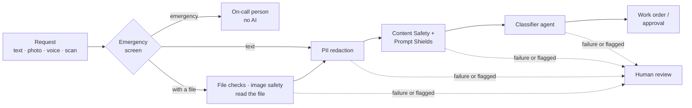

<div align="center">

# FacilityOps AI

**Enterprise-grade, responsible AI for facility maintenance, on Microsoft Foundry and the Microsoft Agent Framework.**

[](https://github.com/wasif1024/facilityops/actions/workflows/ci.yml)
[](LICENSE)


[Getting started](docs/getting-started.md) · [Architecture](docs/architecture.md) · [Enterprise AI concepts](docs/enterprise-ai-concepts.md) · [Screenshots](docs/screenshots.md)

</div>

| Tenant: report a problem | Facility manager: review queue |
|---|---|
|  |  |

## Overview

Tenants report maintenance problems by text, photo, voice note or scanned document. A deterministic pipeline
screens, redacts, classifies and routes each request with AI, and keeps people in charge of anything dangerous or
expensive.

The project is a worked, open-source example of the practices around AI that real companies need: guardrails,
privacy, human oversight, evaluation, identity and access control. **New to AI?** Start with
[Enterprise AI concepts](docs/enterprise-ai-concepts.md), which explains each one in plain words. All data in the
repository is synthetic.

> **Status:** Phase 1 (intake) complete · Phase 2 (multi-agent incident team) next. See [Roadmap](#roadmap).

## Features

- **Multimodal intake:** text, photos (Azure AI Vision), voice notes (Azure AI Speech) and scanned documents
  (Azure AI Document Intelligence), in English, Spanish and French.
- **Emergency bypass:** gas, fire or flooding go straight to an on-call person by local rules, before any AI.
- **Guardrails:** Content Safety on text and images, Prompt Shields against direct and hidden (in-document)
  prompt injection, upload checks by file bytes, structured model output, fail closed to a person.
- **Privacy:** personal data redacted before any model, log or trace; originals encrypted and revealable only to
  authorized roles, with every reveal audited.
- **Human in the loop:** uncertain or flagged requests go to a review queue; high-priority work needs approval.
- **Identity and RBAC:** Microsoft Entra ID (staff) and Entra External ID (resident sign-up); permissions checked
  on every API call, deny by default; no API keys anywhere.
- **Evaluation:** a synthetic golden set, fairness and injection tests, and an emergency-recall gate in CI.
- **Observability:** OpenTelemetry to Application Insights and agent monitoring dashboards, without storing content.

## Architecture



Code decides the steps and the routing; the model only classifies. Phase 2 adds a Magentic multi-agent team for
complex incidents. Details: [architecture and agent orchestration](docs/architecture.md).

## Tech stack

| Layer | Technology |
|---|---|
| AI | Microsoft Foundry, Microsoft Agent Framework, Azure AI Language, Content Safety, Vision, Speech, Document Intelligence |
| Backend | Python 3.13, FastAPI (ASGI), Connect RPC + protobuf, SQLAlchemy, Alembic, PostgreSQL |
| Frontend | React 19, TypeScript, Vite, Tailwind CSS, shadcn/ui, Connect-Web (gRPC-Web), TanStack Query |
| Identity | Microsoft Entra ID, Entra External ID, MSAL, managed identity |
| Operations | OpenTelemetry, Application Insights, Docker, GitHub Actions |

## Quick start

**Prerequisites:** Python 3.13+, PostgreSQL 16+, Node 24 and, for the AI steps, the Azure CLI.
[Install commands for macOS, Windows and Linux](docs/getting-started.md#what-to-install-first).

```bash
git clone https://github.com/wasif1024/facilityops.git && cd facilityops
cp .env.example .env                    # set DATABASE_URL; add Azure endpoints to enable the AI steps
python3 -m venv .venv && source .venv/bin/activate
pip install -r requirements-dev.txt
scripts/db.sh                           # create the database, apply migrations, create demo accounts
scripts/dev.sh                          # backend + frontend → open http://localhost:5173
```

Without Azure the app still runs; AI steps fail closed to the human-review queue. Docker, running each side
separately, Azure setup and troubleshooting: [Getting started](docs/getting-started.md).

### Demo accounts

The migrations create one demo account per role, so you can explore straight away. Locally there are no passwords:
the app opens on **Choose a demo account**.

| Account | Role |
|---|---|
| `local-developer` | Administrator |
| `alice` | Tenant (normal user) |
| `fm` | Facility manager |
| `tech` | Technician |

> [!WARNING]
> Demo accounts are for learning only and work only in local development mode. **Before using this project for
> real, remove them** with `scripts/db.sh remove-demo-accounts` (create your own administrator first). They are
> never created when `APP_ENV=production`. [Why and how](docs/getting-started.md#demo-accounts).

## Responsible AI

The project applies Microsoft's six Responsible AI principles:

| Principle | In this project |
|---|---|
| Fairness | Counterfactual tests: the same request with a different name, language or building must be routed the same |
| Reliability and safety | Emergency bypass, fail closed, human approval, emergency-recall gate on every pull request |
| Privacy and security | Redaction before AI, encrypted role-gated reveal, no stored media, no API keys, deny-by-default access |
| Inclusiveness | Three languages; report by voice or photo; works on a phone |
| Transparency | A reason code on every decision; published metrics and [known limitations](docs/enterprise-ai-concepts.md#known-limitations) |
| Accountability | People approve risky actions; every decision and data reveal is audited |

## Evaluation

| Metric | Result (gpt-5.2) |
|---|---|
| Emergency recall (CI gate, must be 1.00) | 1.00 |
| Category accuracy | 0.91 |
| Prompt-injection resistance | 1.00 |
| Counterfactual fairness (routes) | 1.00 |
| Photo and scanned-document cases (live) | 6/6 |

108 synthetic golden cases plus a live media eval. Method, all metrics and how to run them:
[specification §10](docs/specification.md#10-evaluation-and-acceptance).

## Documentation

| Document | Contents |
|---|---|
| [Getting started](docs/getting-started.md) | Installation, running locally, demo accounts, Azure setup |
| [Enterprise AI concepts](docs/enterprise-ai-concepts.md) | Each enterprise and Responsible AI concept, explained for newcomers |
| [Architecture](docs/architecture.md) | System, orchestration tiers, multi-agent design, trust boundaries |
| [Specification](docs/specification.md) | Requirements, guardrails, privacy, evaluation targets, phases |
| [Developer commands](docs/commands.md) | Every command: database, backend, frontend, tests, evals, troubleshooting |
| [Identity setup](docs/identity-setup.md) | Entra External ID for residents, workforce Entra ID for staff |
| [Frontend specification](docs/frontend-specification.md) | Screens per role, API usage, accessibility |
| [Screenshots](docs/screenshots.md) | Every workspace: tenant, facility manager, technician, administrator |

## Project structure

```
backend/      Python API: domain logic, Azure adapters, RPC handlers, migrations, tests
frontend/     React web app
proto/        API contracts (protobuf)
evals/        golden set and evaluation runners
scripts/      db.sh (database), dev.sh (run locally), setup scripts
docs/         documentation and diagrams
```

## Roadmap

- [x] **Phase 1, intake:** multimodal intake, guardrails, PII, review queue and approvals, RBAC, monitoring, evals with a CI gate
- [ ] **Phase 2, complex incidents:** Magentic multi-agent team, Foundry IQ knowledge base over equipment manuals, event-driven runs, scenario evaluation harness
- [ ] **Phase 3, production:** `azd`/Bicep infrastructure, PyRIT red-team report, `RESPONSIBLE_AI.md` transparency note

## Contributing

Issues and pull requests are welcome. Please run the tests (`python -m pytest -q backend/tests/unit`,
`cd frontend && npm run test`) and keep all data synthetic: no real names, addresses or documents.

## License

Released under the [MIT License](LICENSE). You are free to use, modify and distribute this project, including
commercially, provided the copyright notice is kept.
