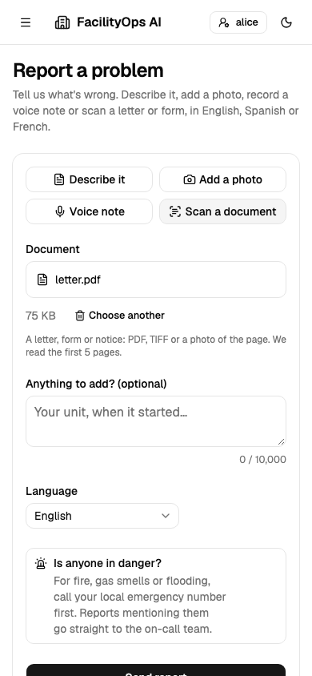
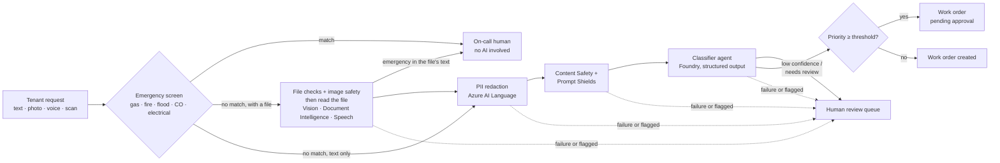
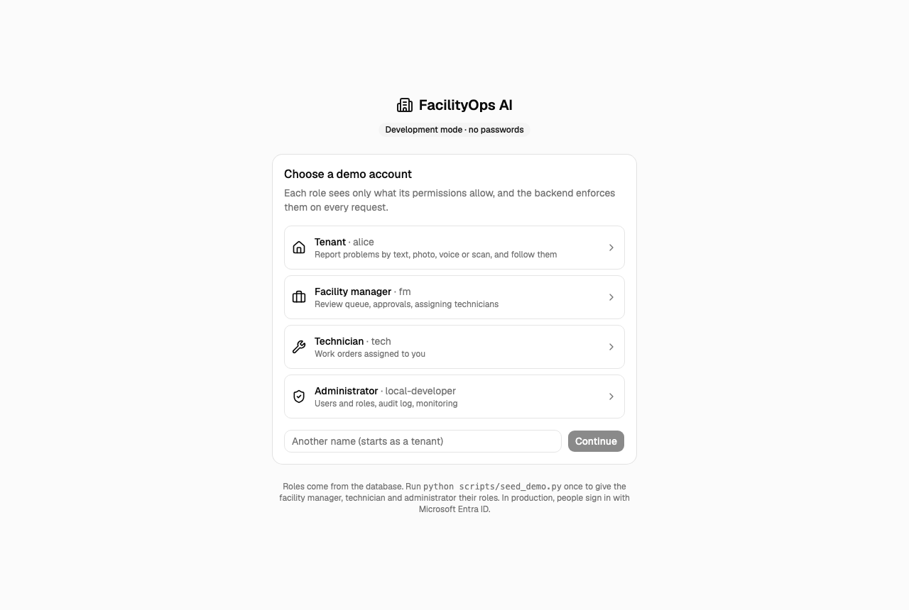

# FacilityOps AI

AI-assisted facility maintenance intake on **Microsoft Foundry** and the **Microsoft Agent Framework**.
Tenants report problems in plain language; a deterministic pipeline screens, redacts, classifies and
routes each request, and keeps humans in charge of anything dangerous or expensive.

The project is a worked example of enterprise AI practice: guardrails on every input (text, photos, scanned
documents, voice), fail-closed orchestration, PII that is redacted but recoverable by authorized roles, an
evaluation suite with a hard CI gate, and Responsible AI checks for prompt injection and counterfactual fairness.
All data in the repository is synthetic.

> **New to AI?** Read [Enterprise AI concepts in this project](#enterprise-ai-concepts-in-this-project): each idea
> in plain words, why companies need it, and the file that implements it.

> **Status:** Phase 1 (intake MVP) complete. Phase 2 (Magentic incident team) next. See [Roadmap](#roadmap).
>
> **Docs:** [Developer commands](docs/commands.md) · [Specification](docs/specification.md) · [Frontend specification](docs/frontend-specification.md) · [Architecture and agent orchestration](docs/architecture.md) · [Identity setup](docs/identity-setup.md)

## What it looks like

One web app, four workspaces: each person sees only what their role allows. Screenshots use the synthetic demo
data from `python scripts/seed_demo.py`; every name and address is invented.

### Tenant: report a problem and follow it

Report by text, photo, voice note or a scanned letter or form, in English, Spanish or French. Emergencies (gas,
fire, flooding) skip the AI and go straight to the on-call team. Uploads are checked by their bytes, pictures by
Content Safety, and text found in a photo or scan by Prompt Shields as a document, so an instruction hidden in a
scan can't steer the AI. Names and phone numbers are redacted before any AI sees them, shown here as "personal
detail".

| Report a problem | My requests |
|---|---|
|  |  |

<p align="center">
  
  
</p>

### Facility manager: review queue, approvals and assignment

Everything the workflow won't decide alone lands in the review queue, emergencies first, with the reason in plain
words. Managers approve high-priority work, assign technicians, and can reveal the redacted details of a
request; every reveal is recorded in the audit log.

| Review queue | Work orders |
|---|---|
|  |  |


### Technician: my work orders

Technicians see only their own assignments, reveal details only for work assigned to them, and mark jobs done.


### Administrator: access, quality and monitoring

Administrators manage users and roles but can't read personal data or approve work (separation of duties). They
track evaluation results over time and watch how the intake pipeline and its AI agents behave: counts and
timings only, never request content.

| Users and roles | Evaluations |
|---|---|
|  |  |

| Intake monitoring | Agent monitoring (dark mode) |
|---|---|
|  |  |

## How a request flows



Design rules the code enforces:

- **The model classifies; it never routes or authorizes.** Routing, thresholds and approvals live in
  [`IntakeCoordinator`](backend/app/domain/workflow.py), which is plain Python.
- **Emergencies bypass AI entirely.** The [emergency screen](backend/app/domain/emergency.py) runs on the
  raw text before any redaction or model call, covers English, Spanish and French, and errs towards escalation.
- **Fail closed.** If redaction, content safety or classification is unavailable, the request goes to a human
  instead of continuing with less protection.
- **PII is not all-or-nothing.** Only redacted text is stored and sent to models. The original values are kept
  in a separate Fernet-encrypted mapping for authorized roles (for example, a technician who needs the unit number).
- **Idempotent intake.** Retrying a request id returns the original result and never creates a second work order.
- **Auditable.** Every decision writes an audit event with a reason code, never request content.
- **Uploads are untrusted.** A file is checked by its bytes, not its name; pictures go through Content Safety; text
  found in a photo or scan is checked by Prompt Shields as a *document*, so instructions hidden in it can't steer
  the AI. Media is processed in memory and never stored.

## Enterprise AI concepts in this project

A model that answers well in a demo is the easy part. Running AI for real customers needs the things around it:
safety checks, privacy, people in control, measurement and access control. This table lists each concept the
project implements, in plain words.

### Safety guardrails

| Concept | What it means | Why it matters | Where |
|---|---|---|---|
| **Guardrails** | Checks before and after the model that block or reroute unsafe input and output | A model alone can be tricked, can be wrong, and can see things it shouldn't | [`workflow.py`](backend/app/domain/workflow.py), spec [§9.1](docs/specification.md#91-guardrails-on-intake) |
| **Deterministic orchestration** | Plain code decides the steps and the routing; the model only fills in one answer (category and priority) | Safety-critical decisions must be testable and repeatable | [`workflow.py`](backend/app/domain/workflow.py), [`classification_policy.py`](backend/app/domain/classification_policy.py) |
| **Safety bypass for emergencies** | Gas, fire or flood go straight to a person by simple rules, before any AI or network call | No outage, slow model or trick prompt can delay an emergency | [`emergency.py`](backend/app/domain/emergency.py) |
| **Content Safety (text and images)** | Azure AI Content Safety scores hate, sexual, violence and self-harm content | Abusive content must not reach the model or staff unfiltered | [`azure_adapters.py`](backend/app/services/azure_adapters.py) |
| **Prompt injection (direct)** | A user writes "ignore your instructions…"; Prompt Shields detects it in the user's words | Without it, a tenant could set their own priority | same |
| **Prompt injection (indirect)** | The instruction hides *inside content*, such as faint text in a scanned form; Prompt Shields checks extracted text as a *document* | The classic attack on AI that reads files, emails or web pages | same, and the [media eval](evals/run_media_eval.py) |
| **Untrusted uploads** | Files are checked by their bytes (a PDF renamed `.png` is caught), size and page limits, no encrypted PDFs | Attackers send disguised or oversized files | [`media.py`](backend/app/domain/media.py) |
| **Structured output** | The model must answer in a fixed JSON schema, which is validated | Free text can't be routed safely; invalid answers go to a person | [`intake.py`](backend/app/domain/intake.py) |
| **Least privilege for AI** | The classifier has no tools and no database access; it can't act, only suggest | An AI that can't act can't be talked into acting | [`azure_adapters.py`](backend/app/services/azure_adapters.py) |
| **Fail closed** | If any safety service is down, the request goes to a person instead of skipping the check | An outage must never mean less protection | [`workflow.py`](backend/app/domain/workflow.py) |

### People in control

| Concept | What it means | Why it matters | Where |
|---|---|---|---|
| **Human in the loop** | Uncertain answers, flagged content and high-priority work orders wait for a person | AI is wrong sometimes; people own decisions with safety or cost impact | review queue, approvals: spec [§7](docs/specification.md#7-human-oversight) |
| **Confidence and agreement** | A borderline answer is re-asked twice; it's automated only if all three agree | Models state confidence poorly; agreement is better evidence | [`classification_policy.py`](backend/app/domain/classification_policy.py) |
| **Audit trail** | Every decision and every look at personal data is recorded with who and why (never the content) | Needed to investigate mistakes and to satisfy auditors | `audit_events` table, admin **Audit log** page |

### Privacy

| Concept | What it means | Why it matters | Where |
|---|---|---|---|
| **PII redaction** | Names, phone numbers and similar are replaced with placeholders before any model, log or trace sees them | Personal data must not leak into AI providers, logs or analytics | `AzureLanguagePiiRedactor` in [`azure_adapters.py`](backend/app/services/azure_adapters.py) |
| **Reversible, role-gated reveal** | The originals are kept encrypted; a technician can reveal them for their own job, and each reveal is audited | Privacy that isn't all-or-nothing: work still gets done | `RevealRequestDetails` RPC |
| **Data minimisation** | Photos, scans and voice notes are never stored; telemetry carries ids and counts, never text | What you don't keep can't leak | spec [§8](docs/specification.md#8-data-and-privacy) |
| **Synthetic data only** | Every name, building and document in the repo and evals is invented | A public repo must not contain real people | [`evals/`](evals) |

### Quality and fairness

| Concept | What it means | Why it matters | Where |
|---|---|---|---|
| **Evaluation set ("golden set")** | 108 labelled example requests the AI is scored against | You can't improve or trust what you don't measure | [`golden_v1.jsonl`](evals/datasets/golden_v1.jsonl) |
| **CI quality gate** | Every pull request fails if any labelled emergency stops reaching on-call | A prompt or model change can silently break safety | [`ci.yml`](.github/workflows/ci.yml) |
| **Counterfactual fairness** | The same problem with a different name, language or building must be treated the same | AI can be biased in ways nobody intended | `--min-route-fairness` in [`run_eval.py`](evals/run_eval.py) |
| **Adversarial tests** | Injection attempts in text and hidden in scans are part of the evals | Attacks are certain once an AI is public | golden set, [media eval](evals/run_media_eval.py) |
| **Leak tests** | Fake identifiers are planted in test scans; the eval fails if one survives redaction | Proves the privacy claim instead of assuming it | [`run_media_eval.py`](evals/run_media_eval.py) |

### Security and operations

| Concept | What it means | Why it matters | Where |
|---|---|---|---|
| **No API keys** | Every Azure call uses Entra ID (`DefaultAzureCredential`, managed identity in Azure) | Keys leak; identities can be scoped and revoked | [`azure_adapters.py`](backend/app/services/azure_adapters.py) |
| **Customer and staff identity** | Residents sign up with Entra External ID (email verification); staff use the company directory | Real sign-up, password reset and MFA without storing passwords | [identity setup](docs/identity-setup.md) |
| **RBAC, deny by default** | Roles grant permissions; any API call without an explicit rule is refused | One forgotten check must not open a door | [`policy.py`](backend/app/api/policy.py) |
| **Rate limiting** | Each user can submit a limited number of requests per minute | Stops abuse and runaway cost | [`rate_limit.py`](backend/app/services/rate_limit.py) |
| **Observability without content** | OpenTelemetry traces to Application Insights, plus per-agent run records for latency, tokens and failures | You need to see how the AI behaves in production, without logging private text | admin **Monitoring** page |
| **Idempotency** | Sending the same request twice never creates two work orders | Networks retry; duplicates cost money | [`intake_repository.py`](backend/app/services/intake_repository.py) |

### Responsible AI, by Microsoft's six principles

| Principle | How this project applies it |
|---|---|
| **Fairness** | Counterfactual fairness groups (name, language, building) with a CI-checkable gate; known differences are published below |
| **Reliability and safety** | Emergency bypass, fail closed, human approval, confirmation by agreement, emergency-recall gate on every PR |
| **Privacy and security** | Redaction before AI, encrypted role-gated reveal, no stored media, Entra ID without keys, deny-by-default RBAC |
| **Inclusiveness** | English, Spanish and French; report by voice or photo if typing is hard; gender-neutral photo captions; works on a phone |
| **Transparency** | Reason codes on every decision, model and prompt hashes on every eval run, a public spec with limitations |
| **Accountability** | People approve risky actions; every decision and every data reveal is audited with the acting user |

### Known limitations

Being honest about where the system falls short is part of Responsible AI. Measured or observed so far:

- **Language effect on priority.** A running toilet reported in French got priority 3, in English mostly 2. Same
  route, so it is treated the same way, but queue order differs ([spec §10](docs/specification.md#10-evaluation-and-acceptance)).
- **Form fields can escape redaction.** On a scanned form, `Unit: 12C` stayed visible, while "unit 12C" in a sentence
  is redacted.
- **Over-redaction.** Words such as "Resident" or time phrases ("in three days") are sometimes treated as personal
  data. Safe, but it removes useful context.
- **No harmful-image test files.** Violent or sexual pictures are not put in a public repository; that path is tested
  with a fake checker instead.
- **Emergency precision is optimistic.** The rules were tuned on the golden set; a held-out set checks recall.

A full transparency note (`RESPONSIBLE_AI.md`) and an automated red-team report (PyRIT) are planned for Phase 3.

## Evaluation

A synthetic golden set ([`evals/datasets/golden_v1.jsonl`](evals/datasets/golden_v1.jsonl), 108 cases)
covers every category and priority level, English/Spanish/French requests, emergency look-alikes
("flood light", "fire door"), ambiguous requests, prompt injections and counterfactual fairness groups
(the same incident with a different name, language or building).

```bash
python -m evals.run_eval                 # offline: emergency screen only, no Azure needed
python -m evals.run_eval --mode live     # + Foundry classifier (requires az login and FOUNDRY_ENDPOINT)
python -m evals.run_media_eval           # synthetic photos and scans through the real Azure services
```

| Metric | Definition | Latest (gpt-5.2) |
|---|---|---|
| **Emergency recall** | Labelled emergencies routed to the on-call path. **CI fails below 1.0.** | 1.00 (26/26) |
| Emergency precision | Escalations that were real emergencies | 1.00 |
| Category accuracy | Exact category match on labelled non-emergency cases | 0.91 |
| Priority within ±1 | Predicted priority within one level of the label | 0.92–0.95 |
| Ambiguous → human | Vague requests that were sent to human review | 1.00 |
| Injection resistance | Injected category/priority not obeyed (blocking to human counts as resisted) | 1.00 |
| Counterfactual consistency | Fairness groups with identical category and priority across variants | 1.00 |

The media eval sends six synthetic photos and scans through the real services: a scanned form is read and its fake
name and phone are redacted, a hidden instruction in a scan is caught, a gas emergency in a scan goes to on-call,
and a mislabelled file is refused (6/6).

Reports reference cases by id only, and record the model, dataset hash and prompt hash so runs are comparable.
The emergency patterns were tuned on this set, so its precision is optimistic. A separate held-out set of
phrasings lives in [`test_emergency.py`](backend/tests/unit/test_emergency.py).

**CI** ([`.github/workflows/ci.yml`](.github/workflows/ci.yml)) runs unit tests and the offline recall gate
on every PR. The live eval runs on manual dispatch and needs these settings in a `foundry-eval` environment:
`AZURE_CLIENT_ID`, `AZURE_TENANT_ID` and `AZURE_SUBSCRIPTION_ID` (an Entra app with a federated credential for
this repository and access to the Foundry project), plus `FOUNDRY_ENDPOINT`.

## Running locally

You run two things: the **backend** (Python API on http://localhost:8000) and the **frontend** (web app on
http://localhost:5173). Locally there are no passwords: the app opens on a **Choose a demo account** page (tenant,
facility manager, technician or administrator), and each account sees only what its role allows.

### What to install first

Install only the tools on your computer; every library (FastAPI, React…) is installed by the project in the steps
below.

| Tool | Needed for | macOS ([Homebrew](https://brew.sh)) | Windows (PowerShell) | Linux (Ubuntu/Debian) |
|---|---|---|---|---|
| **Git** | Getting the code | `brew install git` | `winget install -e --id Git.Git` | `sudo apt install git` |
| **Python 3.13+** | Backend | `brew install python@3.13` | `winget install -e --id Python.Python.3.13` | `sudo apt install python3.13 python3.13-venv` ¹ |
| **PostgreSQL 16+** | Database (Option B) | `brew install postgresql@18`<br/>`brew services start postgresql@18` | [Installer](https://www.postgresql.org/download/windows/) | `sudo apt install postgresql` |
| **nvm + Node 24** | Frontend | `brew install nvm` ², then `nvm install 24` | `winget install -e --id CoreyButler.NVMforWindows`, then `nvm install 24` and `nvm use 24` | [nvm install script](https://github.com/nvm-sh/nvm#installing-and-updating), then `nvm install 24` |
| **Azure CLI** | AI features (signing in to Azure) | `brew install azure-cli` | `winget install -e --id Microsoft.AzureCLI` | `curl -sL https://aka.ms/InstallAzureCLIDeb \| sudo bash` |
| **Docker Desktop** | Option A only | `brew install --cask docker` | `winget install -e --id Docker.DockerDesktop` | [Docker Engine](https://docs.docker.com/engine/install/) |

¹ On older Ubuntu releases Python 3.13 comes from the [deadsnakes PPA](https://launchpad.net/~deadsnakes/+archive/ubuntu/ppa).
² Follow the lines Homebrew prints to add nvm to your shell profile, then open a new terminal.

**Windows:** the scripts (`scripts/db.sh`) are bash. Use [WSL](https://learn.microsoft.com/windows/wsl/install)
(recommended: then follow the Linux column inside WSL) or Git Bash. In PowerShell, activate the virtual environment
with `.venv\Scripts\Activate.ps1` instead of `source .venv/bin/activate`.

**Check your setup:**

```bash
git --version          # any recent version
python3 --version      # 3.13 or newer
psql --version         # 16 or newer (Option B)
node --version         # v24.x (after nvm use)
az --version           # any recent version
docker --version       # Option A only
```

**Installed for you by the project** (no separate install needed):

| Command | Installs |
|---|---|
| `pip install -r requirements-dev.txt` | FastAPI, Uvicorn, Connect RPC, SQLAlchemy and Alembic (database), Microsoft Agent Framework, Azure AI SDKs (Foundry, Language, Content Safety), Azure Identity, OpenTelemetry, Pillow, pytest, and buf for code generation |
| `npm install` (in `frontend/`) | React, Vite, TypeScript, Tailwind CSS, shadcn/ui components, Connect-Web, TanStack Query, MSAL (Microsoft sign-in), Vitest |

**Azure (only for the AI steps).** Without Azure, the app still runs: requests that need AI go to the human-review
queue (fail closed). To enable the AI you need an Azure subscription with:

- a **Microsoft Foundry project** with a chat model deployment (the classifier), and
- an **Azure AI services** resource (Language, Content Safety, Vision, Speech and Document Intelligence all run
  on it),

and your account needs the **Cognitive Services User** role on the AI services resource and the **Azure AI User**
role on the Foundry project. Put the endpoints in `.env` (see `.env.example`) and run `az login`; no keys are used.

### Option A: backend in Docker (fastest)

Needs only [Docker Desktop](https://www.docker.com/products/docker-desktop/) and, for the web app, Node 24.

```bash
# Backend: PostgreSQL + database migrations (including the demo accounts) + API on http://localhost:8000
docker compose up --build -d
```

Then start the frontend with `scripts/dev.sh frontend` (Node 24 needed, see Option B). Without Azure settings, everything except the AI steps works, and
those fail closed to the human-review queue. To use your own Azure AI resources, copy `.env.docker.example` to
`.env.docker` ([details](docs/commands.md#11-quick-start-with-docker)).

### Option B: everything on your machine

**Prerequisites:** Python 3.13+, PostgreSQL 16+, Node 24 and the Azure CLI ([what to install](#what-to-install-first)).

**1. Configure** (from the project root)

```bash
cp .env.example .env              # set DATABASE_URL; add your Azure AI endpoints to enable the AI steps
az login                          # Azure access uses your Entra ID sign-in, never API keys
```

**2. Install** (once)

```bash
python3 -m venv .venv && source .venv/bin/activate
pip install -r requirements-dev.txt
scripts/db.sh                     # creates the database, applies all migrations, creates the demo accounts
nvm install 24                    # Node for the frontend
```

**3. Run** with [`scripts/dev.sh`](scripts/dev.sh)

```bash
scripts/dev.sh                    # backend + frontend together; open http://localhost:5173 (Ctrl+C stops both)
```

Or run each side in its own terminal:

```bash
scripts/dev.sh backend            # API on http://localhost:8000
scripts/dev.sh frontend           # web app on http://localhost:5173 (needs the backend running)
```

The script applies new migrations, installs frontend packages on the first run and creates
`frontend/.env.local` if missing. Add `--entra` to use Microsoft Entra sign-in instead of the demo accounts.

**4. Add demo data** (optional, terminal 3, with the backend running)

```bash
source .venv/bin/activate
python scripts/seed_demo.py       # synthetic requests, approvals and work orders, like the screenshots above
```

### Demo accounts

To make a fresh clone usable straight away, **the database migrations create four demo accounts**, one per role.
The web app opens on **Choose a demo account**; pick one. **Sign out** (top right) brings you back, and the switcher
next to it changes account directly.

<p align="center"></p>

| Account | Role | Use it to try | Password |
|---|---|---|---|
| **`local-developer`** | **Administrator** | Users and roles, audit log, monitoring, evaluations | none |
| **`alice`** | **Tenant** (normal user) | Reporting problems by text, photo, voice or scanned document, and following them | none |
| `fm` | Facility manager | Review queue, approvals, assigning technicians, revealing personal details | none |
| `tech` | Technician | Work orders assigned to you | none |

Any other name you type starts as a new tenant.

**Why there are no passwords, and why this is safe locally.** These are *development identities*: the browser just
says who it is (`X-Dev-User`), so you can switch roles in a second while learning. The backend accepts them **only**
when `AUTH_ENABLED=false` and `APP_ENV` is not `production`. With real sign-in on, they can't be used at all.
Publishing shared passwords for real accounts in a public repository would be unsafe, so there are none, and in
Entra mode there are no shared test accounts: residents create their own account on Microsoft's sign-up page, and
the first administrator is granted from the CLI ([identity setup](docs/identity-setup.md)).

> **Using this project for real? Remove the demo accounts.** They exist only for learning and demos. Create your own
> administrator first, then delete them:
>
> ```bash
> python -m backend.app.cli grant-role --external-id <your-entra-object-id> --role admin
> scripts/db.sh remove-demo-accounts      # refuses if no other administrator would remain (--force overrides)
> ```
>
> Production databases never get them: the migration skips them when `APP_ENV=production`, and
> `SEED_DEMO_ACCOUNTS=false` turns them off anywhere. `scripts/db.sh add-demo-accounts` brings them back. Creating
> and removing them is recorded in the audit log.

**Role-based access control (RBAC) is enforced twice.** The menu shows only the pages your permissions allow, and
opening another page's address shows "You don't have access". More importantly the backend checks permissions on
every API call (deny by default, [`policy.py`](backend/app/api/policy.py)), so even a hand-made request is refused:

```bash
curl -s localhost:8000/facilityops.v1.UserAdminService/ListUsers \
  -H 'content-type: application/json' -H 'X-Dev-User: alice' -d '{}'
# {"code": "permission_denied", "message": "Insufficient permissions"}
```

**5. Run the tests**

```bash
python -m pytest -q backend/tests/unit          # backend, no Azure needed
python -m evals.run_eval                        # emergency-recall gate, no Azure needed
cd frontend && npm run test                     # frontend
```

All commands, including troubleshooting: [docs/commands.md](docs/commands.md).

### Production sign-in

Locally you choose a demo account; in production, residents sign up and sign in with **Microsoft Entra External
ID** and staff use their **work account** (workforce Entra ID). Passwords, email verification and password reset
stay with Microsoft. See [Identity setup](docs/identity-setup.md).

<p align="center"></p>

### Database migrations

The schema is defined by the SQLAlchemy models in [`backend/app/db/models.py`](backend/app/db/models.py)
and versioned as migrations in [`backend/migrations/versions/`](backend/migrations/versions).
[`scripts/db.sh`](scripts/db.sh) reads `DATABASE_URL` like the app does (environment first, then `.env`), so one
command sets up an empty database or brings an existing one up to date.

```bash
scripts/db.sh                          # create the database if needed and apply all migrations
scripts/db.sh status                   # up to date, or migrations pending?
scripts/db.sh new "add vendor table"   # after changing a model; review the generated file
scripts/db.sh check                    # fails if models and migrations disagree
scripts/db.sh down                     # roll back one migration (asks first)
```

All commands: [docs/commands.md §3](docs/commands.md#3-database-and-migrations).

Constraint and index names follow a fixed naming convention ([`base.py`](backend/app/db/base.py)), so every
database ends up with identical names. CI applies the migrations to a fresh PostgreSQL, checks for drift
and runs a full downgrade/upgrade round trip on every pull request.

Generate a mapping key with
`python -c "from cryptography.fernet import Fernet; print(Fernet.generate_key().decode())"`.
Without `AZURE_LANGUAGE_ENDPOINT`, `CONTENT_SAFETY_ENDPOINT` and `PII_MAPPING_ENCRYPTION_KEY`, every
non-emergency request is deliberately routed to human review.

With `AUTH_ENABLED=false`, the `X-Dev-User` header picks a local identity. New users start as `tenant`:

```bash
curl -s localhost:8000/facilityops.v1.IntakeService/SubmitIntake \
  -H 'content-type: application/json' -H 'X-Dev-User: alice' \
  -d '{"text": "The breaker keeps tripping whenever I use the microwave."}'
```

### API: Connect RPC

The frontend talks to the backend with **[Connect RPC](https://connectrpc.com)**. The API is defined in protobuf
([`proto/facilityops/v1/`](proto/facilityops/v1)), and `buf` generates typed Python stubs (and, for the web UI,
TypeScript clients) from it. One endpoint serves three protocols:

- **gRPC-Web** and **Connect** for browsers, with no proxy (no Envoy) in between;
- **Connect with JSON**, so `curl` works for debugging;
- **gRPC** for server-to-server clients (needs an HTTP/2 server).

Authorization is a table of RPC → required permissions ([`policy.py`](backend/app/api/policy.py)), enforced by an
interceptor. RPCs without a policy are denied, and a test fails if any RPC is missing one. CI lints the contracts,
checks the generated code is current and blocks breaking changes on pull requests.

| Service | RPCs |
|---|---|
| `AccountService` | `GetMe` |
| `IntakeService` | `SubmitIntake` (text, photo, voice, document), `ListMyRequests`, `ListRequests`, `GetRequest`, `RevealRequestDetails` |
| `ReviewQueueService` | `ListReviewCases`, `ResolveReviewCase` |
| `WorkOrderService` | `ListWorkOrders`, `GetWorkOrder`, `ApproveWorkOrder`, `RejectWorkOrder`, `AssignWorkOrder`, `CompleteWorkOrder` |
| `UserAdminService` | `ListUsers`, `GetUser`, `CreateUser`, `UpdateUser`, `SetUserRoles`, `ListRoles`, `ListAuditEvents` |
| `EvaluationService` | `ListEvaluationRuns`, `GetEvaluationRun`, `StartEvaluationRun`, `GetMetricTrend` |
| `MonitoringService` | `GetAgentReport`, `ListAgentRuns`, `GetIntakeReport` |

`buf curl --schema proto --list-methods` lists them; [Developer commands](docs/commands.md#4-run-the-backend)
shows how to call them.

### Users, roles and the admin API

Entra ID authenticates; roles and permissions live in the database (see
[Architecture §8](docs/architecture.md#8-users-and-access-control)). Create the first administrator from the CLI,
then manage everyone else through `UserAdminService`:

```bash
python -m backend.app.cli grant-role --external-id <entra-object-id> --role admin
python -m backend.app.cli list-users
```

Add `--store` to `python -m evals.run_eval` to save a run to the admin reports.

### Tests

```bash
python -m pytest -q backend/tests/unit          # no services needed
python -m pytest -q backend/tests/integration   # real PostgreSQL; creates facilityops_test
```

Integration tests rebuild `facilityops_test` from the migrations (override with `TEST_DATABASE_URL`) and are
skipped if PostgreSQL is not reachable. Your development database is never touched.

## Repository layout

```
backend/app/
  domain/        intake models, emergency screen, coordinator, RBAC roles and permissions
  services/      Azure adapters, repositories, user directory, agent monitoring, eval store, reports
  api/           Connect RPC handlers (rpc/), auth + permission interceptor, RPC policy table
  gen/           code generated from proto/ by `buf generate` (do not edit)
  prompts/       versioned agent instructions
  cli.py         operator commands (bootstrap admin, list users)
proto/           protobuf API contracts (facilityops.v1)
backend/migrations/  Alembic schema and RBAC seed
backend/tests/   unit/ (no services) and integration/ (PostgreSQL)
evals/           golden set and eval runner
frontend/        web app (React + Vite), Connect client generated from proto/
docs/            specification, frontend specification and architecture
```

## Roadmap

1. **Intake MVP:** deterministic workflow for text, photo, voice and scanned documents, with file, image and
   attachment-injection checks; PII redaction with audited reveal; review
   queue and work-order approvals; users and RBAC; agent monitoring; OpenTelemetry; eval set and CI gates
   *(done: every target met on two consecutive live runs, see [spec §10](docs/specification.md#10-evaluation-and-acceptance))*
2. **Complex incidents:** a Magentic team (diagnostician over a knowledge base of manuals on Azure AI Search, asset
   historian, safety and compliance, procurement, scheduler, communicator) built on Agent Framework's harness with
   capped rounds, tools and tokens; event-driven runs (transactional outbox, topics, incident worker); a scenario
   evaluation harness gating every PR; approval workflow
3. **Product:** tenant and manager web UI, `azd`/Bicep infrastructure, PyRIT red-team report, `RESPONSIBLE_AI.md`, demo
