# FacilityOps AI — Architecture

How requests flow, how agents are orchestrated, where humans stay in control, and how the project's
development skills guide the code that implements all of this. Requirement ids (FR-x) refer to the
[specification](specification.md).

Diagram legend: solid boxes exist today; boxes marked *Phase 2* or *Phase 3* are designed but not built yet.

1. [System context](#1-system-context)
2. [Backend structure](#2-backend-structure) (including the [Connect RPC API](#21-api-connect-rpc))
3. [Orchestration overview](#3-orchestration-overview)
4. [Tier 1: intake workflow](#4-tier-1-intake-workflow)
5. [Tier 2: Magentic incident team](#5-tier-2-magentic-incident-team)
6. [Human oversight](#6-human-oversight)
7. [Trust boundaries and PII](#7-trust-boundaries-and-pii)
8. [Users and access control](#8-users-and-access-control)
9. [Evaluation and agent monitoring](#9-evaluation-and-agent-monitoring)
10. [Development skills](#10-development-skills)
11. [Key decisions](#11-key-decisions)

## 1. System context

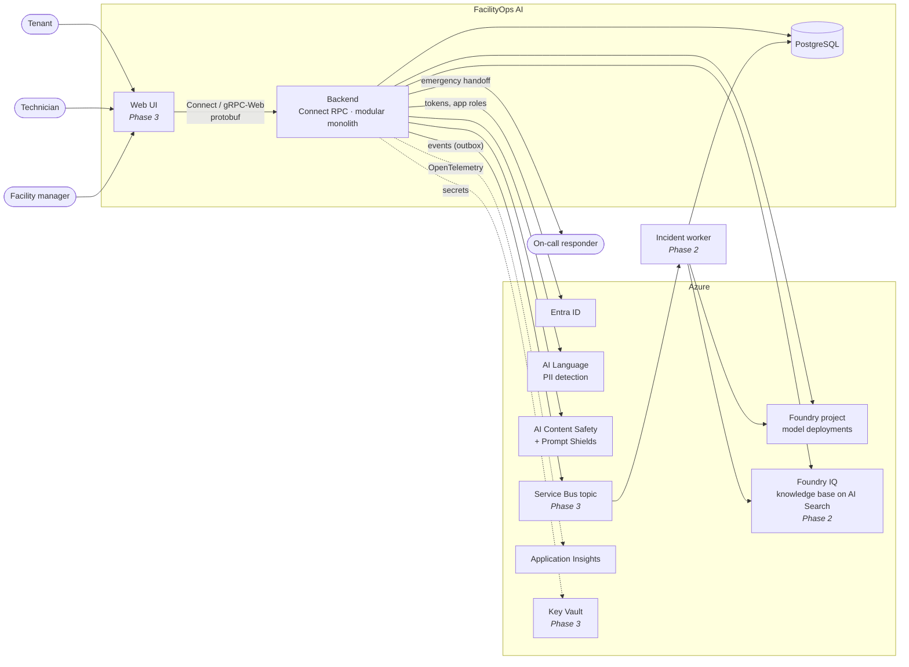

The backend reaches every Azure service with Entra ID (`DefaultAzureCredential` locally, managed identity in
Azure). There are no API keys.

## 2. Backend structure

FacilityOps is a **modular monolith** with a ports-and-adapters core: one deployable ASGI app and one
database. The domain layer depends on interfaces, never on Azure or SQL directly.

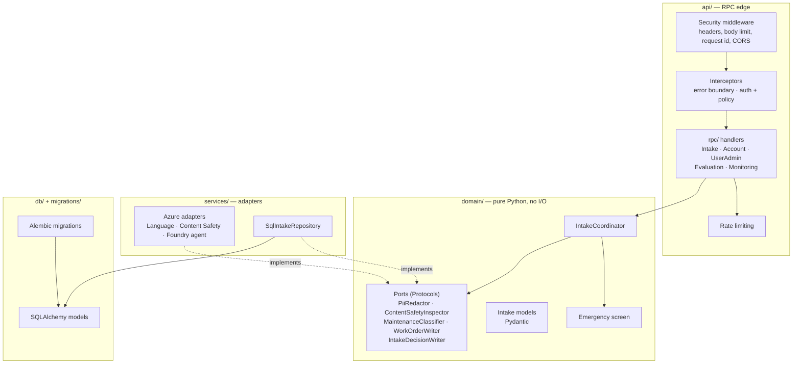

Because the coordinator only knows the ports, unit tests run the whole workflow with fakes and no network.

### 2.1 API: Connect RPC

The frontend↔backend contract is protobuf, in [`proto/facilityops/v1/`](../proto/facilityops/v1). `buf` generates
the server stubs (Python, committed in `backend/app/gen/`) and, for the Phase 3 web UI, typed TypeScript clients.
The services are [Connect RPC](https://connectrpc.com) applications mounted in the ASGI host, so a single port
speaks three wire protocols.

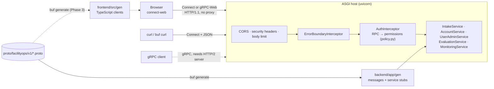

| Design point | Choice |
|---|---|
| Browser transport | **gRPC-Web** (`createGrpcWebTransport` from `@connectrpc/connect-web`, binary protobuf); no Envoy proxy. The same endpoints also accept the Connect protocol, used by `curl` and `buf curl` |
| Authorization | One table maps every RPC to required permissions; missing entries are denied, and a unit test fails if any generated RPC lacks one |
| Errors | Connect codes (`permission_denied`, `invalid_argument`, …). Unexpected exceptions become a generic `internal` error, because the library would otherwise send `str(exception)`, which can contain SQL parameters or request text |
| Contract safety | CI runs `buf lint`, checks generated code is current and runs `buf breaking` against `main` on pull requests |
| Plain HTTP | Only `GET /health/live`, for load balancers |

## 3. Orchestration overview

Two tiers, chosen per request. **Tier 1** is a fixed pipeline in plain Python that handles every request.
**Tier 2** is a dynamic Magentic team for the few incidents that need investigation. Agents in both tiers advise.
Code and people decide.

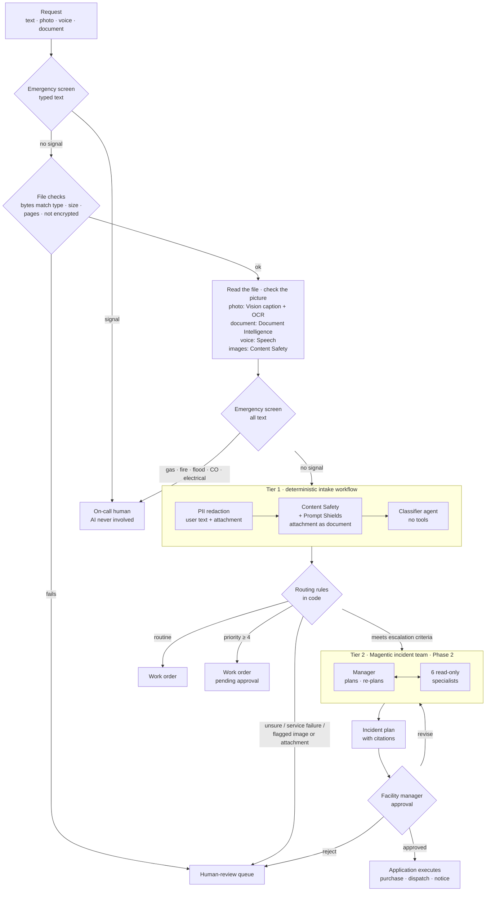

| | Tier 1: workflow | Tier 2: Magentic team |
|---|---|---|
| Runs for | Every request | Escalated incidents only (spec §4.3) |
| Control flow | Fixed, in `IntakeCoordinator` | Chosen by the manager agent at run time |
| Agents | 1 classifier, no tools | Manager + 6 specialists with read-only tools |
| Side effects | Work order / review case via repository | None. The application executes the approved plan |
| Typical cost | 1 model call | Bounded: ≤ 10 rounds, ≤ 60k tokens, ≤ 120 s |
| Failure mode | Human-review queue | Partial plan to human review |

## 4. Tier 1: intake workflow

Implemented in [`workflow.py`](../backend/app/domain/workflow.py) and [`media.py`](../backend/app/domain/media.py).
The order of steps is a safety property: the emergency screen runs first, on raw text and with no network calls, so
neither an Azure outage nor a prompt injection can delay an emergency. Uploaded files are checked by their bytes
(never trusting the declared type) before any service sees them; text from a photo or scan is then screened for
emergencies in full, and passed to Prompt Shields as a *document*, so an instruction hidden in a scan is caught as an
indirect attack rather than mistaken for the tenant's own words.

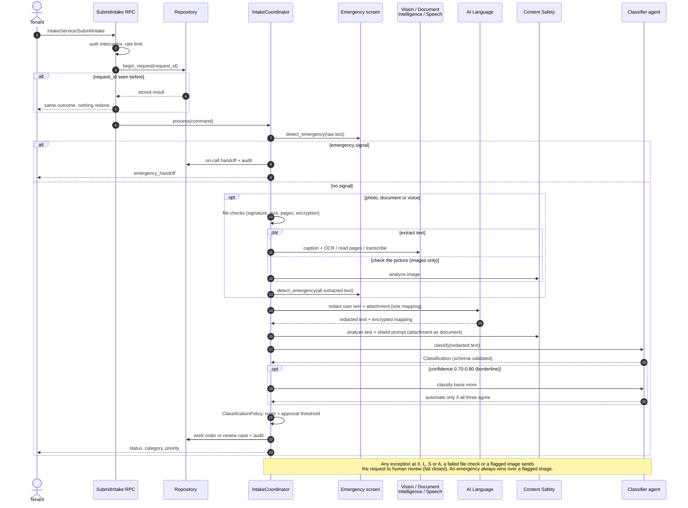

## 5. Tier 2: Magentic incident team

*Phase 2.* Built with `MagenticBuilder` from `agent_framework.orchestrations` (package
`agent-framework-orchestrations`, not installed yet). The manager is a `StandardMagenticManager` on a larger model.
Specialists are **harness agents** (`create_harness_agent`) on smaller models, configured by one FacilityOps
harness profile (§5.4). Runs happen in an **incident worker**, triggered by events, never inside an RPC (§5.5).

### 5.1 Team and tools

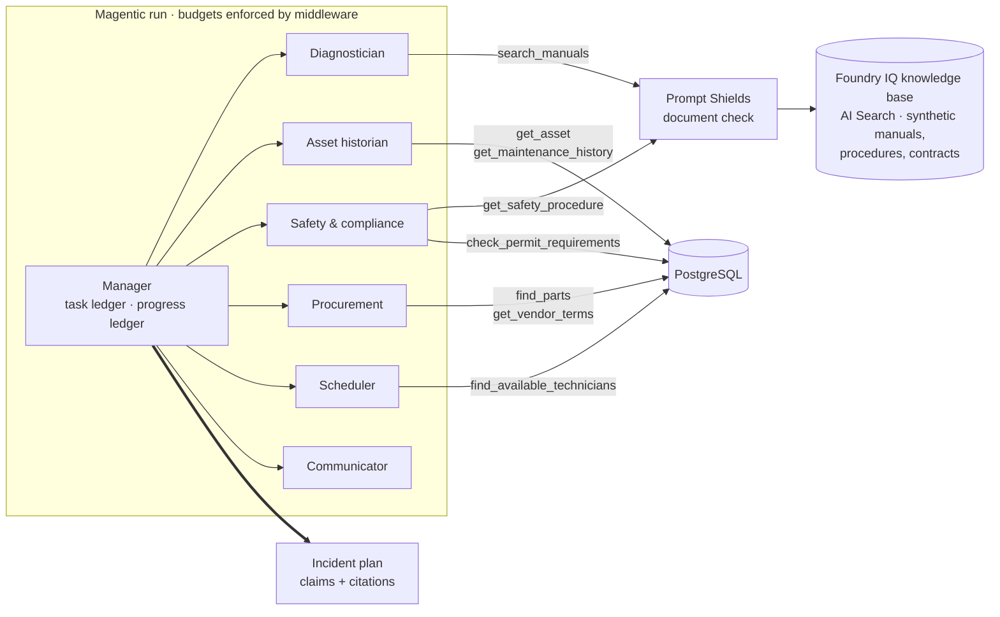

Least privilege is structural: each specialist is built with only its own tools, every tool is read-only, and
the communicator has no tools at all. It drafts a notice, it cannot send one. Nothing in the run can reach the
PII mapping, because it is not exposed by any tool.

### 5.2 The planning loop

The manager keeps two ledgers. The **task ledger** holds facts and the current plan. The **progress ledger** is
re-evaluated each round: is the task done, is progress being made, who speaks next and with what instruction.

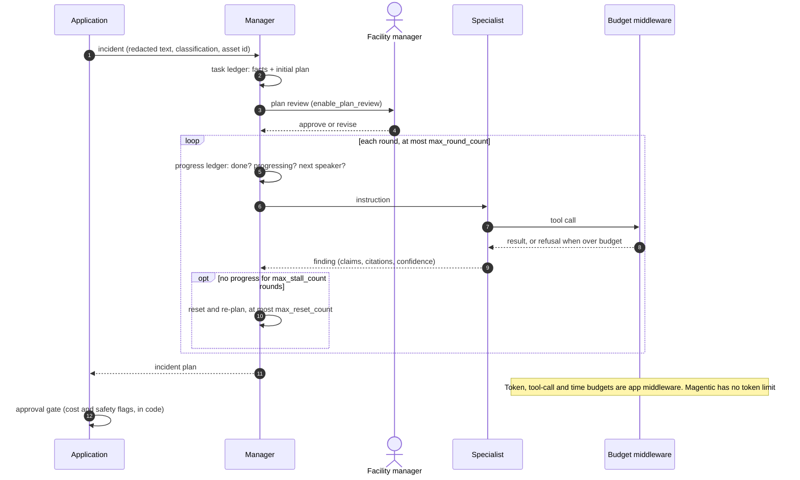

### 5.3 Incident lifecycle

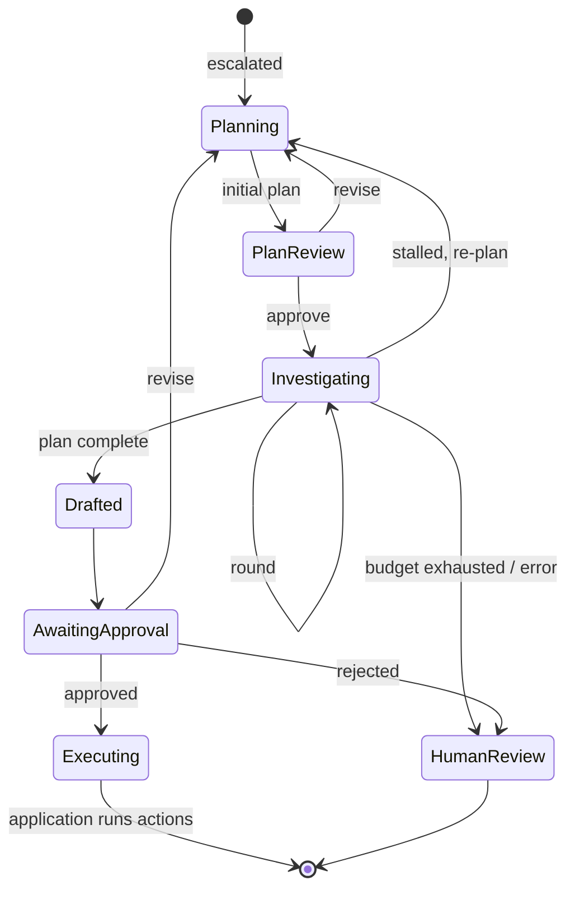

Runs are checkpointed (`checkpoint_storage`), so a run waiting on a person survives a restart.

### 5.4 Inside a specialist: the harness profile

Each specialist is a harness agent with most of the harness switched off. What stays on makes a small agent
reliable; what goes off would let it plan on its own, remember, browse or act. Full table in
[spec §5.3](specification.md#53-agent-runtime-the-harness-profile).

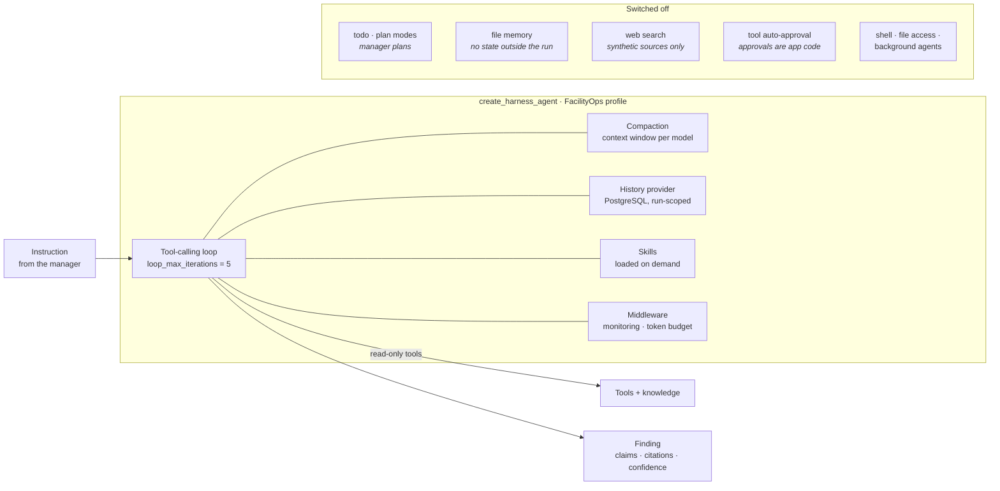

The three ways a specialist gets what it needs are kept apart. **Knowledge** is documents (manuals, procedures,
contracts) in a knowledge base on Azure AI Search, reached only through tools, so every retrieval is budgeted,
screened by Prompt Shields for injected instructions and cited. **Tools** are read-only functions over FacilityOps
data. **Skills** are procedures (how to cite, how to judge a repeat failure) loaded only when relevant.

### 5.4.1 Languages: Azure Translator

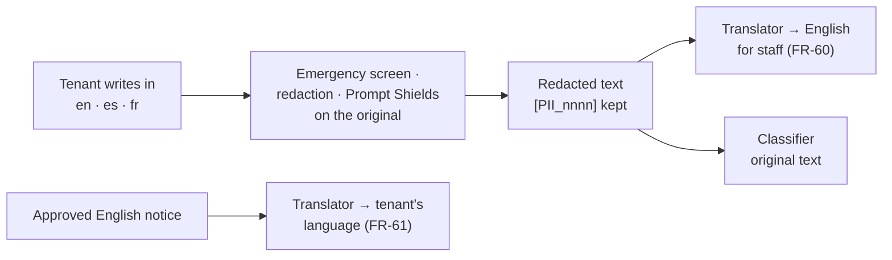

Translator only sees redacted text, runs after every safety step, and its failure never blocks intake. Whether to
classify the English translation instead of the original is decided by measurement (FR-62), not assumed.

### 5.5 Events and topics

Agents *inside* a run talk through Magentic's workflow edges. Agent Framework has no topics. **Topics connect the
application to runs**: a decision is committed with its event (transactional outbox), and a worker subscribed to the
topic starts or resumes the run. A run that waits hours for a manager holds no request open and no process.

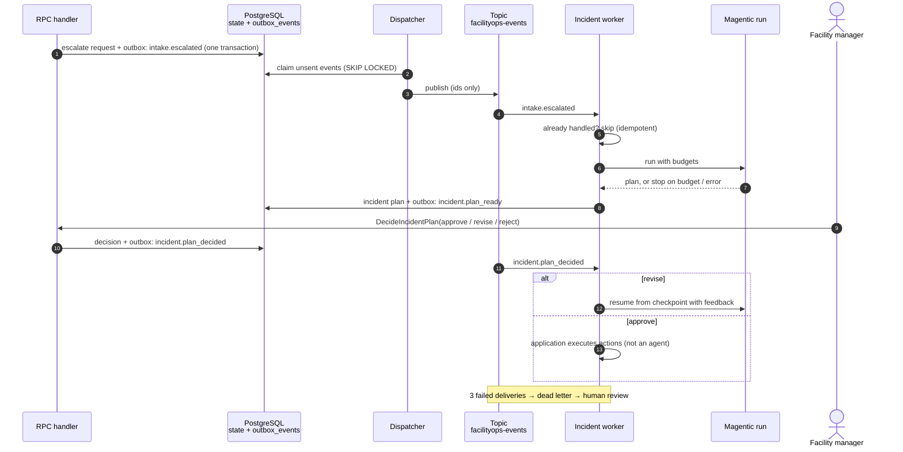

| | Local and tests | Azure (Phase 3) |
|---|---|---|
| Bus | PostgreSQL outbox, polled with `SKIP LOCKED` | Azure Service Bus topic `facilityops-events`, one subscription per consumer, filtered by event type |
| Worker | `scripts/dev.sh worker` (`python -m backend.app.worker`), or the Compose `worker` service | Container App scaled on subscription length |
| Auth | Database connection | Managed identity, no connection strings |

Both transports implement one `EventBus` port, so the domain code and the scenario tests don't know which is used.

## 6. Human oversight

People hold every decision with safety, money or privacy consequences. Models produce inputs to those decisions.

```mermaid
flowchart LR
    subgraph ai["AI may"]
        a1["classify"]
        a2["search and summarize"]
        a3["propose a plan"]
        a4["draft a notice"]
    end
    subgraph code["Code decides"]
        c1["emergency routing"]
        c2["confidence threshold"]
        c3["approval thresholds"]
        c4["role checks"]
    end
    subgraph human["A person decides"]
        h1["emergency response"]
        h2["uncertain requests"]
        h3["priority ≥ 4 work orders"]
        h4["incident plans, spend, safety"]
        h5["PII reveal (audited)"]
    end
    ai --> code --> human
```

### 6.1 Review queue and work-order lifecycle

Requests the workflow will not decide on its own land in the review queue (`ReviewQueueService`), emergencies
first. A facility manager either creates a work order, choosing category and priority (that decision counts as
the approval), or dismisses it with a fixed reason code. Work orders then follow a small state machine
(`WorkOrderService`). Every transition is enforced in code, recorded in `intake_audit_events` with the acting
user, and uses reason codes rather than free text, so the audit trail never collects personal data.

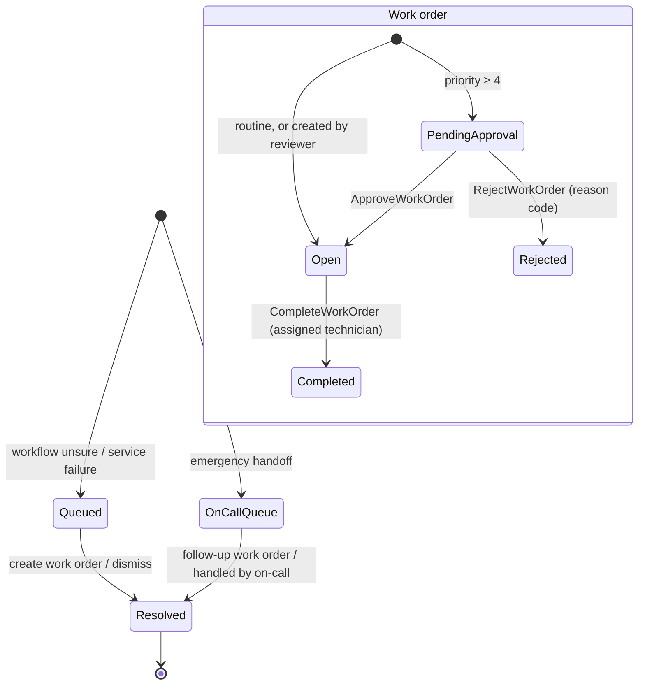

| Who | Can | Scope enforced in |
|---|---|---|
| Facility manager | Resolve review cases; approve, reject and assign work orders; reveal PII for any request | `policy.py` + `OperationsService` |
| Technician | List, read and complete *their own* assignments; reveal PII only for those | `OperationsService` filters by `assigned_technician_id`; others' orders look "not found" |
| Tenant | List and read their own requests with work-order status | `OperationsService` filters by `submitted_by_user_id` |

## 7. Trust boundaries and PII

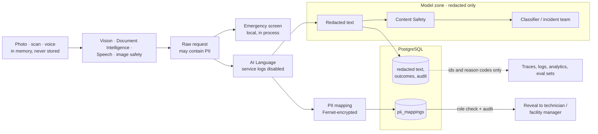

Rules: request text, retrieved documents and tool results are **data, never instructions**. The mapping never
enters a prompt, trace or eval set. A redaction failure blocks model processing instead of forwarding raw text.

## 8. Users and access control

Entra ID answers *who is calling*; the application database answers *what they may do*. Permissions, not roles,
are checked for every RPC, so access can be reshaped in data without touching handler code.

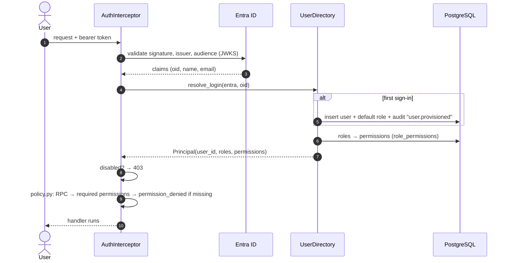

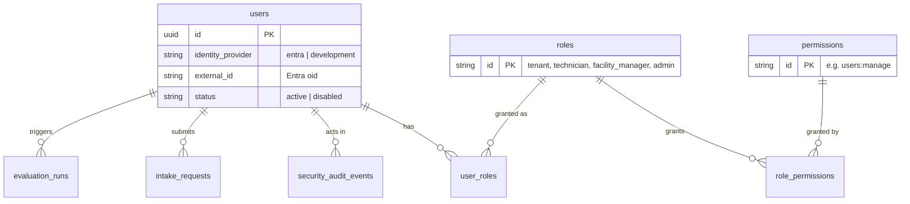

| Rule | Where |
|---|---|
| First sign-in gets `DEFAULT_USER_ROLE` (`tenant`); empty means no access until an admin assigns a role | `UserDirectory.resolve_login` |
| The last active admin cannot be demoted or disabled; nobody can disable themselves | `UserDirectory._require_another_admin` |
| Admin manages access but cannot reveal PII, approve work or submit requests | Seed in migration `0002` |
| Every provisioning and access change writes a `security_audit_events` row, without email addresses | `UserDirectory._audit` |
| Replaying a `request_id` only returns the stored result to the user who submitted it | `SqlIntakeRepository.begin_request` |
| First admin is bootstrapped from the CLI, not the API | `python -m backend.app.cli grant-role` |

Two directories are trusted. **Residents** sign up and sign in with **Entra External ID** (`ciamlogin.com`) and
get the `tenant` role; **staff** use the organisation's **workforce Entra ID** and get no role until an admin
assigns one. Each directory's issuer and signing keys come from its OpenID discovery document; the token's
tenant picks the directory, and signature, audience, issuer and tenant are all verified, so a resident token
can't pose as staff. See [identity setup](identity-setup.md).

In local development (`AUTH_ENABLED=false`) the `X-Dev-User` header selects an identity, so different roles can be
tried without Entra. Production refuses to start with authentication disabled.

## 9. Evaluation and agent monitoring

Two streams feed the admin reports. **Agent runs** are recorded by Agent Framework middleware on every call: one row
per run with agent, model, prompt hash, duration, tokens, outcome and trace id; what was sent and answered is kept
separately and access-controlled (§9.1). **Evaluation runs**
store metrics, gates and per-case results by case id. A context variable tags each agent run with the intake request
or evaluation run it served, so production and evaluation traffic are reported separately and an evaluation's model
cost is visible.

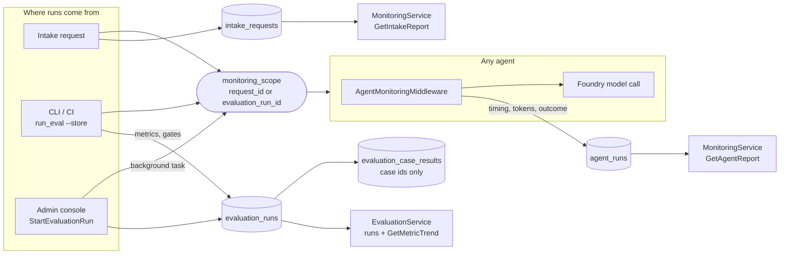

| Report | RPC | Shows | Permission |
|---|---|---|---|
| Agent health | `MonitoringService/GetAgentReport` | Runs, failure rate, p50/p95 latency, tokens per agent and model; daily series; error types | `monitoring:read` |
| Agent runs | `MonitoringService/ListAgentRuns` | Individual runs, filterable by agent, status or evaluation run | `monitoring:read` |
| Intake outcomes | `MonitoringService/GetIntakeReport` | Status mix, human-review and automation rates, categories, priorities, top reason codes, pending approvals | `monitoring:read` |
| Evaluation history | `EvaluationService/ListEvaluationRuns`, `GetEvaluationRun` | Runs with metrics and gates; per-case drill-down (`failed_only`) | `evaluations:read` |
| Metric trend | `EvaluationService/GetMetricTrend` | A metric over time, tagged with model and prompt hash | `evaluations:read` |
| Start a run | `EvaluationService/StartEvaluationRun` | Offline or live run in the background; one at a time | `evaluations:run` |

The same middleware applies unchanged to the Phase 2 specialists, which gives per-specialist cost and latency
without new code.

**Phase 2: incident evaluation harness.** A Magentic run can't be judged by one label, so incidents are replayed as
scenarios against a fixture world (synthetic assets, history, parts, technicians, manual passages). Tools are fakes
that serve the fixtures, record each call and inject faults. Details and targets:
[spec §10.1](specification.md#101-phase-2-incident-evaluation-harness).

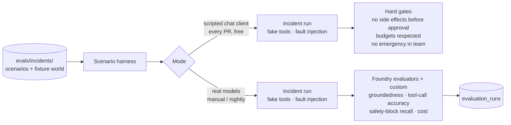

Scripted mode tests the machinery (budgets, events, gates, checkpoint resume) deterministically; live mode tests
model quality.

**OpenTelemetry** complements these tables: tables answer aggregate questions for the admin console, while traces
in Application Insights debug a single request end to end. `configure_telemetry` turns on the Azure Monitor
distro (RPC spans, Azure service calls), one span per intake step (`intake.pii_redaction`,
`intake.classification`, …, carrying only ids and reason codes) and Agent Framework's GenAI spans
(`invoke_agent`, `chat <model>` with token usage). Content is excluded on purpose: GenAI sensitive-data capture
is off, step spans don't record exception messages, and the error interceptor logs only the exception type,
because any of these could otherwise carry request text into telemetry. Tests never export.

### 9.1 Transparency: the decision trail

Every request can be explained after the fact, long after traces expire. Four records connect through the request
id and the OpenTelemetry trace id:

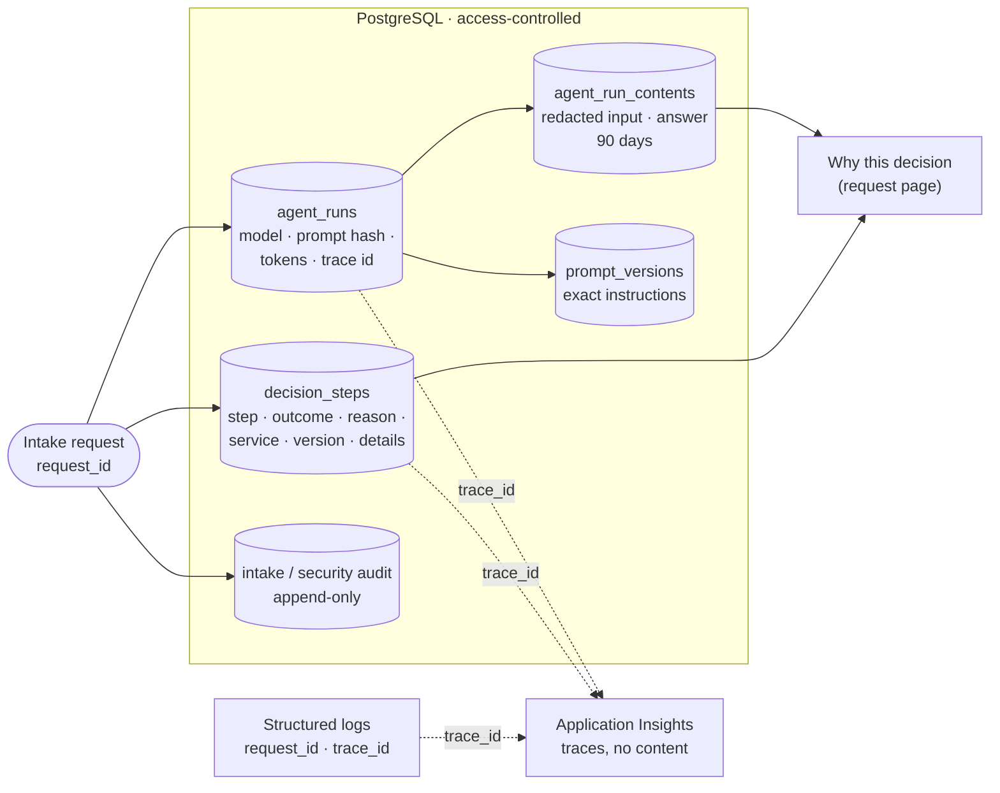

| Question | Answered by | Who can see it |
|---|---|---|
| Which checks ran, what did each find, which version ran it? | `decision_steps` | `decisions:read` (facility managers, admins) |
| Which model and prompt version answered, how many tokens, how long? | `agent_runs`, `prompt_versions` | `decisions:read` |
| What exactly was the model sent, and what did it answer? | `agent_run_contents` (redacted text) | `intake:read_all` (facility managers); every view audited |
| Who approved, assigned, dismissed or revealed? | `intake_audit_events`, `security_audit_events` | staff / `audit:read` |
| How did this request travel through the services? | Application Insights trace (by `trace_id`) | operations |

Content stays out of traces on purpose: Application Insights is usually readable by more people than the database.
The audit tables are append-only (database triggers); `scripts/db.sh purge-expired` is the only path past them,
and only for rows older than their retention period.

## 10. Development skills

The repository ships **agent skills** in [`.agents/skills/`](../.agents/skills): short procedures that coding
agents (Claude Code, GitHub Copilot and similar) load when a task touches a given area. They are not part of the
running system. They encode the rules above, so that code written by an AI assistant follows the same safety
properties as the architecture.

### 10.1 Which skill guards which part

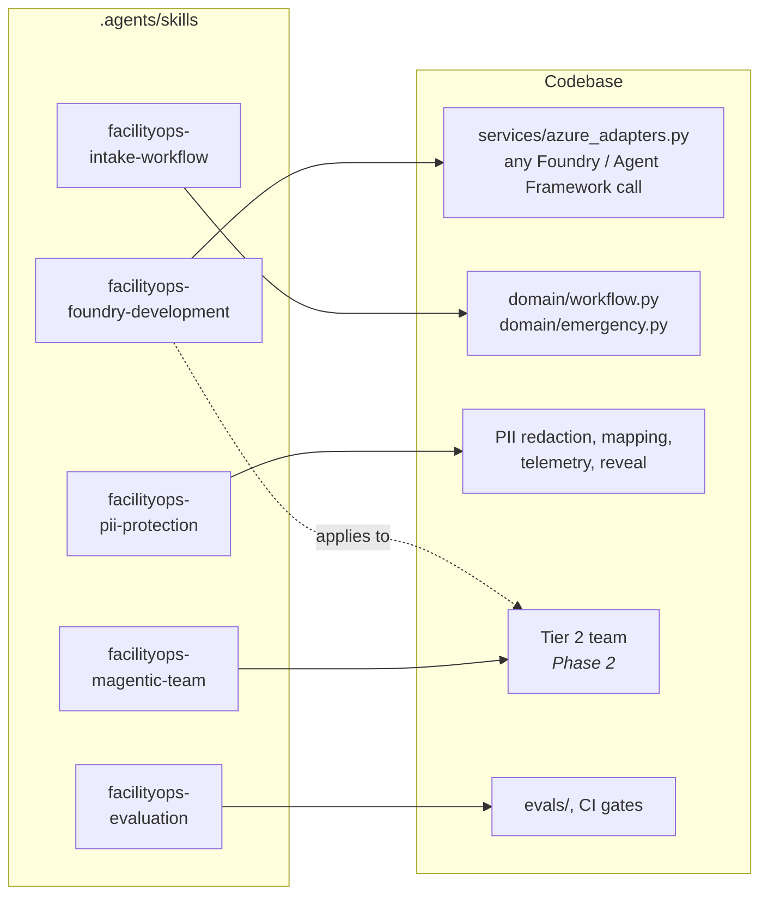

| Skill | Loads when a task… | Key rules it enforces |
|---|---|---|
| `facilityops-foundry-development` | uses Foundry, Agent Framework, Entra ID or Azure AI services | Check current Microsoft docs before writing SDK calls; reuse the existing project; Entra ID only; bound every agent loop; no secrets in tracked files |
| `facilityops-intake-workflow` | changes intake, triage, emergency handling or work orders | Emergency screen before any AI; fail closed; schema-validated classification; idempotent retries; audit without PII |
| `facilityops-pii-protection` | touches redaction, mappings, logs, traces or eval data | Redact before any model or telemetry; mapping behind a role check; audit reveals; test for leaks with planted synthetic identifiers |
| `facilityops-magentic-team` | builds the Phase 2 team | Emergencies never enter; explicit round, token, tool and time limits; read-only least-privilege tools; citations required; no side effects without approval |
| `facilityops-evaluation` | changes datasets, evaluators or CI gates | Synthetic, versioned data; emergency recall is a hard gate; counterfactual fairness pairs; report case ids, not content |

### 10.2 How a skill shapes a change

```mermaid
sequenceDiagram
    autonumber
    actor Dev as Developer
    participant CA as Coding agent
    participant SK as Skill
    participant Repo as Codebase
    participant CI as CI

    Dev->>CA: "add the scheduler specialist"
    CA->>SK: match task to skill descriptions
    SK-->>CA: magentic-team + foundry-development procedures
    CA->>CA: check current Agent Framework docs (skill step)
    CA->>Repo: code with read-only tools, budgets, tests
    CA->>Repo: run unit tests and eval
    Repo->>CI: pull request
    CI->>CI: tests · emergency-recall gate · migration drift check
    CI-->>Dev: pass or fail with case ids
```

Skills and CI back each other up. A skill tells the coding agent the rule, and CI checks the result. For example,
the intake skill requires emergencies to bypass AI, and the eval gate fails the PR if a labelled emergency stops
being routed to on-call.

## 11. Key decisions

| Decision | Why | Trade-off |
|---|---|---|
| Deterministic workflow for intake, agents only for bounded tasks | Safety-critical routing must be testable and auditable | Less flexible than an all-agent design |
| Emergency screen as local rules, before redaction | No outage or injection can delay an emergency; < 1 s | Rules need curation; measured by the recall gate |
| Fail closed to human review | Degraded service never means less protection | More manual work during outages |
| Magentic only for escalated incidents | Dynamic planning is costly; most requests don't need it | Two orchestration styles to maintain |
| Read-only specialists; the application executes | Agent output is never authorization | Extra approval step before action |
| Modular monolith | One team, transactional consistency, simple ops | Scale the whole app together; the incident worker is a second process from the same codebase |
| Check uploads by their bytes; attachment text is a Prompt Shields *document* | The declared type is client-chosen; text inside a scan is third-party content, the classic route for indirect injection | A legitimate file in an odd container lands in human review |
| Flagged image goes to a person, never dismissed | A burst pipe or an injury photo can score high on "violence"; dropping it could hide a real problem | Reviewers see the redacted text and reason, not the picture (media is never stored) |
| Encrypted PII mapping beside redacted text | Operational details recoverable without exposing PII to models or analytics | Key management; reveal endpoint must be audited |
| Entra ID everywhere, no keys | No secrets to leak or rotate in code | Local dev needs `az login` |
| Entra authenticates, the database authorizes | Admins manage roles in-app with an audit trail; fine-grained permissions | App owns role data; first admin needs a CLI bootstrap |
| Connect RPC over protobuf instead of REST | One typed contract generates server stubs and browser clients; gRPC-Web without a proxy; `buf breaking` protects clients | Not browsable like Swagger (use `buf curl`); Python Connect library is still Beta; native gRPC needs an HTTP/2 server |
| Confirm borderline classifications by agreement | Model confidence clusters on a few values; a single threshold flipped identical requests between automation and review. Agreement automates more (89% vs 74%) at the same accuracy | About 1.7 classifier calls per request instead of 1 |
| Agent monitoring as framework middleware in PostgreSQL | One hook covers every agent; reports join with eval runs and intake | Not a replacement for distributed tracing |
| Store model inputs and answers in the database, not in traces | Transparency needs the exact prompt and answer; the database has role-based access, audit and retention, App Insights doesn't | Extra storage; content is purged after 90 days |
| Append-only audit tables enforced by triggers | Evidence must not be editable, even by the application | Corrections are new records; the purge needs a special session flag |
| Specialists on Agent Framework's harness, most features off | Reuse a maintained tool loop, compaction and history instead of writing them; switching off memory, web search, planning and auto-approval keeps least privilege | Profile must be re-checked when the harness adds default-on features |
| Foundry IQ knowledge base, only through our tools | Managed agentic retrieval with citations, on the existing serverless search service; our wrapper gives retrieval the same budget, injection screening and audit as any tool call | Agents don't use the knowledge base's MCP endpoint directly; serverless tier may still be in preview |
| Events with a transactional outbox; topics only between runs | Long runs and human waits leave the request path; no lost or phantom events; same code on PostgreSQL locally and Service Bus in Azure | At-least-once delivery means every consumer must be idempotent |
| Scenario harness with a scripted model in CI | Orchestration guarantees are tested on every PR, deterministically and at no model cost | Scripted runs say nothing about model quality; live runs still needed |
