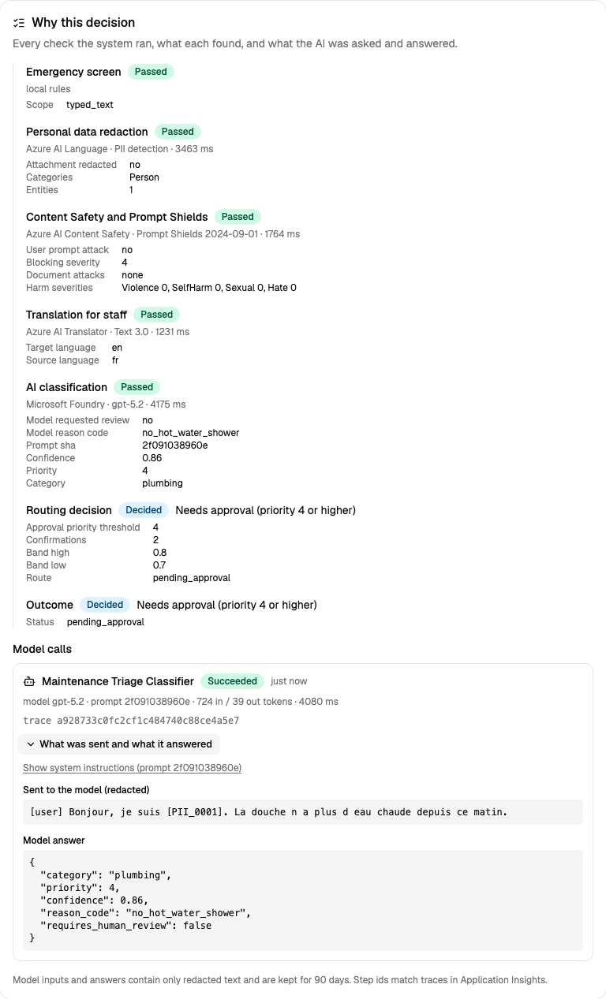

# Enterprise AI concepts in FacilityOps AI

A model that answers well in a demo is the easy part. Running AI for real customers needs the things around it:
safety checks, privacy, people in control, measurement and access control. This page explains every concept the
project implements, in plain words, with the file that implements it. It is written for people new to AI.

## Design rules the code enforces

- **The model classifies; it never routes or authorizes.** Routing, thresholds and approvals live in
  [`IntakeCoordinator`](../backend/app/domain/workflow.py), which is plain Python.
- **Emergencies bypass AI entirely.** The [emergency screen](../backend/app/domain/emergency.py) runs on the
  raw text before any redaction or model call, covers English, Spanish and French, and errs towards escalation.
- **Fail closed.** If redaction, content safety or classification is unavailable, the request goes to a human
  instead of continuing with less protection.
- **PII is not all-or-nothing.** Only redacted text is stored and sent to models. The original values are kept
  in a separate Fernet-encrypted mapping for authorized roles (for example, a technician who needs the unit number).
- **Idempotent intake.** Retrying a request id returns the original result and never creates a second work order.
- **Auditable.** Every decision writes an audit event with a reason code, never request content.
- **Uploads are untrusted.** A file is checked by its bytes, not its name; pictures go through Content Safety; text
  found in a photo or scan is checked by Prompt Shields as a *document*, so instructions hidden in it can't steer
  the AI. Media is processed in memory and never stored.

## Safety guardrails

| Concept | What it means | Why it matters | Where |
|---|---|---|---|
| **Guardrails** | Checks before and after the model that block or reroute unsafe input and output | A model alone can be tricked, can be wrong, and can see things it shouldn't | [`workflow.py`](../backend/app/domain/workflow.py), spec [§9.1](specification.md#91-guardrails-on-intake) |
| **Deterministic orchestration** | Plain code decides the steps and the routing; the model only fills in one answer (category and priority) | Safety-critical decisions must be testable and repeatable | [`workflow.py`](../backend/app/domain/workflow.py), [`classification_policy.py`](../backend/app/domain/classification_policy.py) |
| **Safety bypass for emergencies** | Gas, fire or flood go straight to a person by simple rules, before any AI or network call | No outage, slow model or trick prompt can delay an emergency | [`emergency.py`](../backend/app/domain/emergency.py) |
| **Content Safety (text and images)** | Azure AI Content Safety scores hate, sexual, violence and self-harm content | Abusive content must not reach the model or staff unfiltered | [`azure_adapters.py`](../backend/app/services/azure_adapters.py) |
| **Prompt injection (direct)** | A user writes "ignore your instructions…"; Prompt Shields detects it in the user's words | Without it, a tenant could set their own priority | same |
| **Prompt injection (indirect)** | The instruction hides *inside content*, such as faint text in a scanned form; Prompt Shields checks extracted text as a *document* | The classic attack on AI that reads files, emails or web pages | same, and the [media eval](../evals/run_media_eval.py) |
| **Untrusted uploads** | Files are checked by their bytes (a PDF renamed `.png` is caught), size and page limits, no encrypted PDFs | Attackers send disguised or oversized files | [`media.py`](../backend/app/domain/media.py) |
| **Structured output** | The model must answer in a fixed JSON schema, which is validated | Free text can't be routed safely; invalid answers go to a person | [`intake.py`](../backend/app/domain/intake.py) |
| **Least privilege for AI** | The classifier has no tools and no database access; it can't act, only suggest | An AI that can't act can't be talked into acting | [`azure_adapters.py`](../backend/app/services/azure_adapters.py) |
| **Fail closed** | If any safety service is down, the request goes to a person instead of skipping the check | An outage must never mean less protection | [`workflow.py`](../backend/app/domain/workflow.py) |

## People in control

| Concept | What it means | Why it matters | Where |
|---|---|---|---|
| **Human in the loop** | Uncertain answers, flagged content and high-priority work orders wait for a person | AI is wrong sometimes; people own decisions with safety or cost impact | review queue, approvals: spec [§7](specification.md#7-human-oversight) |
| **Confidence and agreement** | A borderline answer is re-asked twice; it's automated only if all three agree | Models state confidence poorly; agreement is better evidence | [`classification_policy.py`](../backend/app/domain/classification_policy.py) |
| **Audit trail** | Every decision and every look at personal data is recorded with who and why (never the content) | Needed to investigate mistakes and to satisfy auditors | `audit_events` table, admin **Audit log** page |

## Privacy

| Concept | What it means | Why it matters | Where |
|---|---|---|---|
| **PII redaction** | Names, phone numbers and similar are replaced with placeholders before any model, log or trace sees them | Personal data must not leak into AI providers, logs or analytics | `AzureLanguagePiiRedactor` in [`azure_adapters.py`](../backend/app/services/azure_adapters.py) |
| **Reversible, role-gated reveal** | The originals are kept encrypted; a technician can reveal them for their own job, and each reveal is audited | Privacy that isn't all-or-nothing: work still gets done | `RevealRequestDetails` RPC |
| **Data minimisation** | Photos, scans and voice notes are never stored; telemetry carries ids and counts, never text | What you don't keep can't leak | spec [§8](specification.md#8-data-and-privacy) |
| **Privacy-safe translation** | Requests are translated for staff only after redaction; the placeholders survive, and a translation that loses one is thrown away | Translation services must not become a side door for personal data | `AzureTranslator` in [`azure_adapters.py`](../backend/app/services/azure_adapters.py) |
| **Synthetic data only** | Every name, building and document in the repo and evals is invented | A public repo must not contain real people | [`evals/`](../evals) |

## Quality and fairness

| Concept | What it means | Why it matters | Where |
|---|---|---|---|
| **Evaluation set ("golden set")** | 108 labelled example requests the AI is scored against | You can't improve or trust what you don't measure | [`golden_v1.jsonl`](../evals/datasets/golden_v1.jsonl) |
| **CI quality gate** | Every pull request fails if any labelled emergency stops reaching on-call | A prompt or model change can silently break safety | [`ci.yml`](../.github/workflows/ci.yml) |
| **Counterfactual fairness** | The same problem with a different name, language or building must be treated the same | AI can be biased in ways nobody intended | `--min-route-fairness` in [`run_eval.py`](../evals/run_eval.py) |
| **Adversarial tests** | Injection attempts in text and hidden in scans are part of the evals | Attacks are certain once an AI is public | golden set, [media eval](../evals/run_media_eval.py) |
| **Leak tests** | Fake identifiers are planted in test scans; the eval fails if one survives redaction | Proves the privacy claim instead of assuming it | [`run_media_eval.py`](../evals/run_media_eval.py) |

## Transparency and traceability

| Concept | What it means | Why it matters | Where |
|---|---|---|---|
| **Decision trail** | Every check recorded per request: what ran, what it found, which version, how long | "Why did the AI do that?" must have an answer months later | [`decision_trail.py`](../backend/app/domain/decision_trail.py), **Why this decision** on the request page |
| **Model input and output** | The exact (redacted) text sent to the model, its answer, and the system instructions behind each prompt version | Explaining a model decision needs what it actually saw and said | [`agent_monitoring.py`](../backend/app/services/agent_monitoring.py) |
| **Access to explanations** | Managers see prompts and answers; admins see only metadata; every view is audited | Explanations contain request content, so they get the same protection | `GetDecisionTrail` RPC |
| **Correlated logs and traces** | Every log line, trace and trail step shares a request id and trace id | One request can be followed across all systems | [`logs.py`](../backend/app/core/logs.py) |
| **Tamper-resistant audit** | Audit tables refuse edits and deletes at the database level | Evidence you can edit isn't evidence | migration [`0006`](../backend/migrations/versions/0006_decision_trail.py) |
| **Retention** | Model content kept 90 days, audit two years, then purged | Keep what's needed, no longer | `scripts/db.sh purge-expired` |

## Security and operations

| Concept | What it means | Why it matters | Where |
|---|---|---|---|
| **No API keys** | Every Azure call uses Entra ID (`DefaultAzureCredential`, managed identity in Azure) | Keys leak; identities can be scoped and revoked | [`azure_adapters.py`](../backend/app/services/azure_adapters.py) |
| **Customer and staff identity** | Residents sign up with Entra External ID (email verification); staff use the company directory | Real sign-up, password reset and MFA without storing passwords | [identity setup](identity-setup.md) |
| **RBAC, deny by default** | Roles grant permissions; any API call without an explicit rule is refused | One forgotten check must not open a door | [`policy.py`](../backend/app/api/policy.py) |
| **Rate limiting** | Each user can submit a limited number of requests per minute | Stops abuse and runaway cost | [`rate_limit.py`](../backend/app/services/rate_limit.py) |
| **Observability without content** | OpenTelemetry traces to Application Insights, plus per-agent run records for latency, tokens and failures; content stays in the access-controlled database | You need to see how the AI behaves in production without spreading request text | admin **Monitoring** page |
| **Idempotency** | Sending the same request twice never creates two work orders | Networks retry; duplicates cost money | [`intake_repository.py`](../backend/app/services/intake_repository.py) |

## Responsible AI, by Microsoft's six principles

| Principle | How this project applies it |
|---|---|
| **Fairness** | Counterfactual fairness groups (name, language, building) with a CI-checkable gate; known differences are published below |
| **Reliability and safety** | Emergency bypass, fail closed, human approval, confirmation by agreement, emergency-recall gate on every PR |
| **Privacy and security** | Redaction before AI, encrypted role-gated reveal, no stored media, Entra ID without keys, deny-by-default RBAC |
| **Inclusiveness** | English, Spanish and French; report by voice or photo if typing is hard; gender-neutral photo captions; works on a phone |
| **Transparency** | Reason codes on every decision, model and prompt hashes on every eval run, a public spec with limitations |
| **Accountability** | People approve risky actions; every decision and every data reveal is audited with the acting user |

## Known limitations

Being honest about where the system falls short is part of Responsible AI. Measured or observed so far:

- **Language effect on priority.** A running toilet reported in French got priority 3, in English mostly 2. Same
  route, so it is treated the same way, but queue order differs ([spec §10](specification.md#10-evaluation-and-acceptance)).
- **Form fields can escape redaction.** On a scanned form, `Unit: 12C` stayed visible, while "unit 12C" in a sentence
  is redacted.
- **Over-redaction.** Words such as "Resident" or time phrases ("in three days") are sometimes treated as personal
  data. Safe, but it removes useful context.
- **No harmful-image test files.** Violent or sexual pictures are not put in a public repository; that path is tested
  with a fake checker instead.
- **Emergency precision is optimistic.** The rules were tuned on the golden set; a held-out set checks recall.

A full transparency note (`RESPONSIBLE_AI.md`) and an automated red-team report (PyRIT) are planned for Phase 3.
