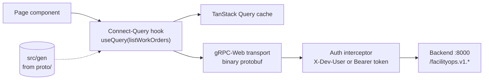

# FacilityOps AI — Frontend Specification (Phase 1)

| | |
|---|---|
| **Version** | 1.1 |
| **Status** | Built (Phase 1); see §13 for what changed during the build |
| **Last updated** | 2026-10-17 |
| **Backend contract** | [`proto/facilityops/v1/`](../proto/facilityops/v1) · [Specification](specification.md) · [Architecture](architecture.md) |

This document specifies the web frontend for the Phase 1 backend: what each user sees, which RPC each screen
calls, which permission unlocks it, and how the app handles identity, errors and personal data. It is the source
of truth for the build in [`frontend/`](../frontend); a screen is done when its acceptance criteria hold.

Markers: ✅ built · ⬜ planned · 🔧 needs a backend change (listed in §11).

## 1. Goals and non-goals

**Goals**

1. Give each role a focused workspace for the Phase 1 features: tenants report problems and follow them,
   technicians work their assignments, facility managers run the review queue and approvals, and administrators
   manage access and watch quality.
2. Stay a thin, typed client of the protobuf contract. No hand-written request or response types.
3. Show only what the caller may do. The UI is driven by the permissions the backend returns, never by role
   names, and the backend still enforces everything.
4. Treat personal data with the same care as the backend: revealed values are shown on demand, never stored or
   logged by the browser.
5. Be a readable reference for people learning the stack.

**Non-goals (Phase 1)**

- Push notifications, offline mode, native mobile apps. (Phase 2 incident plans are in §6.3.)
- Translating the interface itself (tenants can *report* in English, Spanish or French; the UI text is English
  and structured for later translation, §9.4).
- Server-side rendering. This is a static single-page app served by any static host.

## 2. Technology

| Concern | Choice | Why |
|---|---|---|
| Runtime | **Node 24 LTS** (`.nvmrc`) | Required by the current toolchain (protoc-gen-es, React Router 8 and Vitest 5 need Node ≥ 22) |
| Language and UI | **React 19 + TypeScript** | Widely known; strict typing end to end |
| Build and dev server | **Vite 8** on `http://localhost:5173` | Fast; the backend's CORS default already allows this origin |
| Styling and components | **Tailwind CSS 4 + shadcn/ui** (Radix primitives) | Accessible primitives, components copied into the repo so learners can read and change them |
| Icons | lucide-react | Bundled with shadcn/ui |
| API client | **gRPC-Web** through Connect for Web (`@connectrpc/connect-web`) with **protobuf-es v2** messages generated by `buf` | Same contract as the backend; real gRPC semantics in the browser without a proxy; binary protobuf on the wire |
| Server state | **TanStack Query 5** via **Connect-Query** (`@connectrpc/connect-query`) | Caching, loading and error states, and cache invalidation per RPC, generated from the service descriptors |
| Routing | **React Router 8** | Nested layouts and route guards |
| Forms | React Hook Form + Zod | Validation matches the backend rules (§9.2) |
| Charts | Recharts (through shadcn/ui charts) | Monitoring and evaluation trends |
| Notifications | sonner (toasts) | Success and error feedback |
| Identity | Development header switcher; **MSAL** (`@azure/msal-browser`, `@azure/msal-react`) for Entra ID | Matches the backend's two auth modes (§4) |
| Tests | Vitest + Testing Library (jsdom); oxlint; `tsc --noEmit` | Run in CI |

## 3. Architecture

### 3.1 Folder structure

```
frontend/
  buf.gen.yaml          generates src/gen from ../proto (protoc-gen-es, target=ts)
  src/
    gen/                generated messages and service descriptors (do not edit)
    api/                transport, auth interceptor, error mapping, enum labels
    auth/               identity providers (dev switcher, MSAL), session context, permission hooks
    components/ui/      shadcn/ui components
    components/         shared app components (layout, status badges, empty states, tables)
    features/           one folder per area: report, requests, review, work-orders, users, audit,
                        evaluations, monitoring; each owns its pages and components
    lib/                formatting, media helpers, utilities
    routes.tsx          route table with permission guards
    main.tsx            providers: query client, transport, session, router
```

### 3.2 Talking to the backend



- **Transport:** `createGrpcWebTransport({ baseUrl: VITE_API_BASE_URL, useBinaryFormat: true })`. gRPC-Web is
  the browser form of gRPC: status and messages travel in the response body because browsers can't read HTTP/2
  trailers. The backend serves it directly, so there is no Envoy proxy. Binary keeps
  photo and voice uploads small (JSON would base64 them).
- **Interceptor:** adds the identity header to every call (§4) and `X-Request-ID` for correlation with backend
  traces.
- **Queries and mutations:** Connect-Query hooks generated per RPC. Mutations invalidate the queries they
  affect, for example resolving a review case invalidates `listReviewCases`, `listRequests` and
  `listWorkOrders`.
- **Errors:** `ConnectError` codes map to user messages in one place (§9.1).

### 3.3 Generated code

`npm run generate` runs `buf generate` with [`frontend/buf.gen.yaml`](../frontend/buf.gen.yaml), reading
`../proto` and writing `src/gen`. Generated files are committed so the app builds without the toolchain, and CI
fails if they are stale, mirroring the backend.

## 4. Identity and access

### 4.1 Two modes, matching the backend

| | Development (`VITE_AUTH_MODE=dev`) | Production (`VITE_AUTH_MODE=entra`) |
|---|---|---|
| Sign-in | A **Choose a demo account** page (no passwords) before anything loads; no default identity. Sign out returns to it; an identity switcher in the header changes account | A sign-in page with two doors (MSAL redirect): **residents** sign in or create an account with **Entra External ID**; **staff** use their **workforce Entra ID** account. See [identity setup](identity-setup.md) |
| Request header | `X-Dev-User: <name>` | `Authorization: Bearer <access token>` for the API scope |
| Backend setting | `AUTH_ENABLED=false` | `AUTH_ENABLED=true` plus `ENTRA_EXTERNAL_*` (residents) and/or `ENTRA_TENANT_ID`, `ENTRA_API_AUDIENCE` (staff) |
| Token storage | none | MSAL `sessionStorage` cache; never `localStorage` |

Development mode never falls back to a default identity: until an account is chosen, no API call is made, and
choosing (or switching) always starts on that account's landing page. The dev switcher offers recent names and free text (validated against the backend rule `^[a-z0-9._-]{1,64}$`),
remembers the choice in `localStorage` (a convenience, not a secret) and shows a persistent "Development
identity" badge so screenshots can't be mistaken for production.

### 4.2 Session and permissions

On start, and whenever the identity changes, the app calls **`AccountService.GetMe`**. The response
(`userId`, `displayName`, `roles`, `permissions`) is the session. Every navigation item, route and action button
is shown only if the session holds the required permission, with a single helper: `can("work_orders:approve")`.
Routes the user can't use render a "You don't have access" page rather than redirecting silently. A
`permission_denied` from any RPC (for example after an admin removes a role) refreshes the session.

The landing route depends on permissions: tenants land on **Report a problem**, technicians on **My work
orders**, facility managers on **Review queue**, admins on **Users**.

## 5. Navigation

| Section | Route | Visible with | Primary RPCs |
|---|---|---|---|
| Report a problem | `/report` | `intake:submit` | `SubmitIntake` |
| My requests | `/requests/mine`, `/requests/:id` | `intake:read_own` | `ListMyRequests`, `GetRequest` |
| My work orders | `/work-orders?mine`, `/work-orders/:id` | `work_orders:read_assigned` | `ListWorkOrders`, `GetWorkOrder`, `CompleteWorkOrder`, `RevealRequestDetails` |
| Review queue | `/review` | `review_queue:manage` | `ListReviewCases`, `ResolveReviewCase` |
| Work orders | `/work-orders`, `/work-orders/:id` | `work_orders:read_all` | `ListWorkOrders`, `ApproveWorkOrder`, `RejectWorkOrder`, `AssignWorkOrder` |
| All requests | `/requests`, `/requests/:id` | `intake:read_all` | `ListRequests`, `GetRequest`, `RevealRequestDetails` |
| Monitoring | `/monitoring` | `monitoring:read` | `GetAgentReport`, `ListAgentRuns`, `GetIntakeReport` |
| Evaluations | `/evaluations`, `/evaluations/:id` | `evaluations:read` | `ListEvaluationRuns`, `GetEvaluationRun`, `GetMetricTrend`, `StartEvaluationRun` |
| Users | `/admin/users`, `/admin/users/:id` | `users:read` | `ListUsers`, `GetUser`, `CreateUser`, `UpdateUser`, `SetUserRoles`, `ListRoles` |
| Audit log | `/admin/audit` | `audit:read` | `ListAuditEvents` |

Layout: a left sidebar grouped as **Work** (report, requests, work orders, review queue), **Insights**
(monitoring, evaluations) and **Administration** (users, audit), each group hidden when empty. On screens
narrower than 768 px the sidebar becomes a menu sheet; the tenant screens are designed mobile-first, because
tenants report from their phones.

## 6. Screens by role

Every list screen has explicit **loading** (skeletons), **empty** (a sentence plus the next action) and **error**
(message plus retry) states, server-side paging with the RPC's `limit`/`offset`, and keeps filters in the URL
query string so views can be shared and survive reloads.

### 6.1 Tenant

**Report a problem** (`/report`) · `SubmitIntake` ✅

- A four-way switch: **Describe it** (text), **Add a photo**, **Voice note**, **Scan a document** (two by two on phones).
- Text: textarea, 1 to 10,000 characters with a live counter.
- Photo: file picker with `accept="image/*" capture="environment"` (opens the camera on phones), preview, and an
  optional caption. Images larger than 2,048 px on the long side are downscaled in the browser to JPEG before
  upload, so phone photos fit the 8 MiB limit.
- Voice: record and stop with `MediaRecorder` (WebM/Opus in Chromium and Firefox, MP4/AAC in Safari, both
  accepted by the backend), a timer, playback before sending, and a 2-minute cap. If the browser has no
  microphone permission, explain how to grant it and offer a file upload instead.
- Document: file picker for PDF, TIFF, JPEG or PNG. PDF and TIFF are sent as they are (shown by file name);
  a photo of a page is downscaled to 3,000 px on the long side, more than photos, so small print stays readable.
  The hint says only the first 5 pages are read. Files over 8 MiB are refused in the browser with a clear message.
- Language: English, Spanish or French (`language` field), defaulting to the browser language when supported.
- A client-generated `requestId` (UUID) is created when the form opens and reused on retry, so a double submit
  or a flaky network never creates two requests (the backend is idempotent per `requestId`).
- **Result panel**, by status:
  - `EMERGENCY_HANDOFF`: a prominent red panel, "We've alerted the on-call team", plus the advice to call the
    local emergency number if anyone is in danger. Never phrased as "a work order was created".
  - `WORK_ORDER_CREATED`: category, priority and "A technician will be assigned".
  - `PENDING_APPROVAL`: "A facility manager will review this shortly."
  - `HUMAN_REVIEW`: "A person will review your request." No reason codes are shown to tenants.
- Acceptance: a text, photo, voice and document request each reach the backend with the right `source` and `mediaType`; a
  network retry reuses the `requestId`; the emergency panel can't be dismissed by accident.

**My requests** (`/requests/mine`) · `ListMyRequests` ✅

- Cards (mobile) or a table (desktop): submitted time, a short excerpt of the redacted description, status badge,
  category, and work-order status when there is one.
- Status wording is tenant-friendly (§8). Placeholders such as `[PII_0001]` are rendered as a neutral
  "(personal detail)" chip: tenants see their own redacted text but never the mapping.

**Request detail** (`/requests/:id`) · `GetRequest` ✅

- Timeline: submitted → routed (emergency, automatic, approval, review) → work order status.

### 6.2 Technician

**My work orders** (`/work-orders`, technician view) · `ListWorkOrders` (always only the caller's) ✅

- Default filter **Open**; tabs for Open and Completed. Sorted by priority, then age (the backend's order).
- Each row: priority, category, excerpt, age.

**Work-order detail** (`/work-orders/:id`) · `GetWorkOrder`, `RevealRequestDetails`, `CompleteWorkOrder` ✅

- The redacted description with placeholders shown as "(hidden detail)" chips.
- **Reveal details** button (§7): calls `RevealRequestDetails` and substitutes the values in place.
- **Mark as completed** with a confirmation dialog; disabled unless the order is open and assigned to the caller.

### 6.3 Facility manager

**Review queue** (`/review`) · `ListReviewCases`, `ResolveReviewCase` ✅

- Emergencies pinned on top with a red marker, then oldest first (the backend's order). Filter: open (default),
  emergencies only, include resolved.
- Each case shows why it is here in plain words (§8): for example `classification_unconfirmed` → "The AI wasn't
  consistent", `prompt_attack_detected` → "Blocked by Prompt Shields", `pii_redaction_unavailable` → "AI services
  unavailable".
- **Resolve** opens a side panel:
  - **Create work order**: category and priority (1 to 5), prefilled with the classifier's suggestion when there is
    one.
  - **Dismiss**: a reason from the fixed list (duplicate, not actionable, out of scope, handled by on-call,
    resolved by tenant, abusive or spam). No free-text field, by design: decisions must not collect personal data.
  - Optional **Reveal details** (§7) when the redacted text isn't enough to decide.
- Acceptance: a resolved case leaves the open queue without a reload; resolving an already-resolved case shows
  the backend's message and refreshes the list.

**Work orders** (`/work-orders`, manager view) · `ListWorkOrders`, `Approve`/`Reject`/`AssignWorkOrder` ✅ 🔧

- Tabs: Pending approval (default), Open, Completed, Rejected. Each row shows who it's assigned to, or "Unassigned".
  (A server-side "unassigned only" filter is a possible later addition; filtering one page in the browser would
  mislead across pages.)
- **Approve** (one click with undo-free confirmation) and **Reject** (reason from the fixed list).
- **Assign** opens a technician picker. 🔧 The picker needs a list of active technicians that facility managers
  are allowed to read; today only `UserAdminService.ListUsers` returns users, and it requires `users:read`, which
  managers don't have. See §11.
- Assigned technicians are shown by name (from the same list), not by id.

**Incident team panel** (on the request and work order pages) · `ListIncidents(request_id)`, `GetIncident`,
`DecideIncidentPlan`, `EscalateRequest` ✅

- Shown with `incidents:read`. While the team works (escalated, investigating, revising) the panel says so and
  refreshes every few seconds; the worker runs off the request path.
- The latest plan: summary, review flags (safety block, high cost, unverified claims), a red alert with the safety
  notes, the evidence (each claim with its specialist and citations, or "Unverified: no source cited"), the proposed
  actions with their targets and costs, open questions, and earlier versions with their feedback.
- **Approve plan** opens a confirmation that says what the application will then do; a high-cost plan needs the cost
  ticked first; a safety-blocked plan can't be approved (the button is disabled and says why). **Ask for a revision**
  takes a note for the team; **Reject** takes a reason from the fixed list.
- After approval each action shows what the application did (Done, Requested, Queued, Recorded, or Needs a person
  with the reason).
- **Send to incident team** (`incidents:manage`) on requests without an incident and on review-queue cards, never on
  emergencies.
- Tenants never see the plan: their request shows "Being investigated" while the team has it
  (`IntakeRequestSummary.incident_status`).
- **Notice to the tenant** (after approval, `SendTenantNotice`): the communicator's English draft in editable
  fields, a note naming the language it will be machine-translated into, and **Approve and send** (disabled while
  the text holds a `[PII_…]` placeholder). Sent notices are listed. Tenants see them on their request page under
  **Messages from facility management**, in their language with a *Machine translation from English* note and the
  original one click away (`GetRequestResponse.notices`).

**All requests** (`/requests`) · `ListRequests`, `GetRequest`, `RevealRequestDetails` ✅

- Filter by status; links to the work order and review case when present.

### 6.4 Administrator (and facility managers with insights permissions)

**Users** (`/admin/users`) · `ListUsers`, `GetUser`, `CreateUser`, `UpdateUser`, `SetUserRoles`, `ListRoles` ✅

- Table: name, email, identity provider, roles (badges), status, last sign-in. Search (name or email), filter by
  role and status.
- **Add user** (pre-provision staff): Entra object id, display name, email, roles.
- **Edit roles**: checkboxes from `ListRoles`, each with its description and permissions on hover, so admins see
  what they grant. Saving shows the backend's message on refusal, for example "At least one active administrator
  must remain".
- **Disable / enable** with a confirmation that names the user. Your own row can't be disabled (the button is
  hidden and the backend also refuses).

**Audit log** (`/admin/audit`) · `ListAuditEvents` ✅

- Newest first: time, actor, action, target, details rendered as readable key/values (for example "roles added:
  technician"). Filter by action.

**Monitoring** (`/monitoring`) · `GetAgentReport`, `ListAgentRuns`, `GetIntakeReport` ✅

- Window selector: 1, 7, 30 or 90 days; a toggle to include evaluation traffic (off by default).
- **Intake**: stat tiles (requests, automation rate, human-review rate, emergency handoffs, pending approvals,
  average confidence), status-by-day stacked bars, category and priority breakdowns, top reason codes.
- **Agents**: per-agent table (runs, failure rate, p50/p95 latency, tokens, average tokens per run, last run),
  runs and tokens per day, error types. A **Recent runs** table filterable by status links each run to its
  request or evaluation.

**Evaluations** (`/evaluations`, `/evaluations/:id`) · `ListEvaluationRuns`, `GetEvaluationRun`,
`GetMetricTrend`, `StartEvaluationRun` ✅

- Runs table: started, mode, source (CLI, CI, admin), model, prompt hash, status, key metrics, and gate badges.
- **Start run** (only with `evaluations:run`): choose offline or live; the new run appears as *running* and the
  list polls every 5 seconds until it finishes. A second start while one is running shows the backend's message.
- **Trend chart**: pick a metric (emergency recall, category accuracy, route fairness, route self-agreement…),
  plotted over runs with the prompt hash on hover, so a prompt change is visible as a step.
- **Run detail**: metrics with gates, failing-check lists, and a case table (case id, tags, expected vs predicted,
  failures) with a "failed only" toggle. Case text is not shown: the backend never returns it (§7).

## 7. Personal data in the browser

The backend redacts personal data and lets authorized roles reveal it. The frontend must not undo that care.

- **Placeholders** (`[PII_0001]`) are rendered as neutral chips, not raw tokens.
- **Reveal is explicit:** a button labelled "Reveal personal details", a note that the reveal is recorded in the
  audit log, and values shown inline with a highlight.
- **Revealed values live only in component state:** never in the query cache (the reveal RPC is called with
  caching disabled), `localStorage`, `sessionStorage`, URLs, logs or error reports. They disappear when the
  user navigates away, and automatically after 2 minutes.
- **No analytics or session-replay tools** are added in Phase 1.
- Error messages from the backend are already free of personal data; the frontend shows them as they are and
  never echoes what the user typed.

## 8. Presentation rules

- **Status labels** are defined once (`src/api/labels.ts`) per audience, for example `INTAKE_STATUS_HUMAN_REVIEW`
  → "Being reviewed" for tenants and "Human review" for staff.
- **Reason codes** map to short explanations for staff; unknown codes fall back to a humanized version of the
  code, so new backend codes never break the UI.
- **Priority** 1 to 5 is shown as a labelled badge (Low, Normal, Medium, High, Urgent) with the number.
- **Times** use the browser locale; lists show relative time ("12 min ago") with the exact time on hover.
- **64-bit integers** (token totals) arrive as `bigint` from protobuf-es and are formatted with
  `Intl.NumberFormat`.
- **Colour is never the only signal:** every status badge has text, and emergency styling also uses an icon.

## 9. Cross-cutting requirements

### 9.1 Errors

| Connect code | User sees | App does |
|---|---|---|
| `unauthenticated` | "Please sign in again" | Starts sign-in (Entra mode) |
| `permission_denied` | "You don't have access to this" | Refreshes the session (§4.2) |
| `invalid_argument`, `failed_precondition`, `already_exists`, `not_found` | The backend's message (safe by design) | Keeps the form open with the input |
| `resource_exhausted` | "Too many requests; try again in a minute" | Disables the submit button until the reset time (`X-RateLimit-Reset`) |
| `unavailable`, `internal`, network errors | "Something went wrong on our side" | Offers retry; queries retry twice with backoff |

### 9.2 Validation

Client-side rules mirror the backend so users get immediate feedback, but the backend stays authoritative: text up
to 10,000 characters (required for text requests), media up to 8 MiB with the backend's allowed types, priority 1
to 5, dev user names `^[a-z0-9._-]{1,64}$`, Entra object ids `^[A-Za-z0-9._-]{1,128}$`.

### 9.3 Accessibility

WCAG 2.2 AA: keyboard access everywhere (Radix primitives), visible focus, labelled form controls, live regions for
async results (the intake result is announced), sufficient contrast in light and dark themes, and no
information conveyed by colour alone. Recording has a keyboard-operable start and stop.

### 9.4 Internationalization

Phase 1 UI text is English but kept in one place per feature, so a translation library can be added without
touching components. Dates and numbers already use `Intl` with the browser locale.

### 9.5 Security

- No secrets in the bundle; only public settings (`VITE_*`). The Entra client id and tenant id are public values.
- Access tokens stay in MSAL's session cache; nothing sensitive in `localStorage`.
- The development identity switcher is compiled out of production builds (`VITE_AUTH_MODE=entra`).
- Works under a strict Content Security Policy: no inline scripts, `connect-src` limited to the API origin.

### 9.6 Performance

Route-level code splitting (charts load only on Insights pages), image downscaling before upload, list paging on
the server, and TanStack Query caching with a 30-second stale time for lists.

## 10. Configuration

| Variable | Example | Purpose |
|---|---|---|
| `VITE_API_BASE_URL` | `http://localhost:8000` | Backend origin |
| `VITE_AUTH_MODE` | `dev` or `entra` | Identity mode (§4) |
| `VITE_ENTRA_CLIENT_ID` | GUID | SPA app registration (Entra mode) |
| `VITE_ENTRA_TENANT_ID` | GUID | Tenant (Entra mode) |
| `VITE_ENTRA_API_SCOPE` | `api://<api-app-id>/access_as_user` | Scope requested for the API token |

Development: `cd frontend && npm install && npm run dev` with the backend on port 8000 (native or Docker). The
backend's `FRONTEND_ORIGINS` already allows `http://localhost:5173`.

## 11. Backend changes required

| # | Change | Why | Status |
|---|---|---|---|
| B1 | `WorkOrderService.ListTechnicians` returning active technicians (id, display name, open load), requiring `work_orders:assign` | Facility managers must pick a technician to assign, and show assignees by name, without the admin-only `users:read` | ✅ |
| B2 | Store the original text of **emergency** reports encrypted with the PII key, and return it through the audited `RevealRequestDetails` | The emergency screen hands off before any network call, so nothing is redacted or stored: managers and on-call staff see no text for emergencies. Encryption is local, so the handoff stays instant. Stores raw personal data (encrypted), so it needs an explicit decision | ⬜ recommended |

Every other screen maps to an existing RPC and permission.

## 12. Quality and acceptance

- `npm run lint`, `npm run typecheck`, `npm run test` and `npm run build` pass, in CI as well.
- Unit and component tests cover: permission gating (navigation and actions), the error mapping, label and
  placeholder rendering, the reveal lifecycle (values cleared on unmount and after the timeout), media
  downscaling, and idempotent submit (a retry reuses the `requestId`).
- Manual acceptance pass per role against a local backend with Docker, following §6.
- Phase 1 frontend is done when every screen in §6 meets its acceptance criteria and B1 is in place.

**Verified (2026-10-17):** 21 Vitest tests, and a browser walkthrough with Playwright against the real backend
and Azure services: a tenant reported by text (classified and routed to approval) and an emergency (on-call
panel); a facility manager approved and assigned the work order and revealed details; the technician revealed
and completed it; the tenant saw it as done; admin pages, monitoring in light and dark, and evaluations rendered
with no console errors and no horizontal overflow at 1280 px and 390 px.

## 13. Changes made during the build

| Spec said | Built | Why |
|---|---|---|
| ESLint | **oxlint** (Vite template default) | Same purpose, much faster; CI runs it |
| — | **Own theme provider** instead of `next-themes` | `next-themes` injects an inline script, which breaks the strict CSP in §9.5 and warns under React 19 |
| Chart colours from the shadcn preset | **Validated categorical palette** in fixed order (blue, orange, aqua, yellow, magenta), checked for colour-vision deficiency in light and dark | The preset's chart colours are grey shades: stacked series were indistinguishable. Three light-mode colours sit under 3:1 contrast, so every chart has a "View as table" |
| Gate badges per run | **"2/2 gates"** under the run status, names on hover | Per-gate badges overflowed the table |
| "Unassigned" work-order filter | Dropped; each row shows its assignee | The backend has no such filter, and filtering one page in the browser would mislead |
| `shadcn` as a dependency | **devDependency** | Only its CSS is used at build time; as a runtime dependency it pulled a CLI with a known advisory into the runtime set (now 0 runtime vulnerabilities) |
| Emergency requests show their text | Explain that emergencies store no text | The backend stores none (B2 above) |
