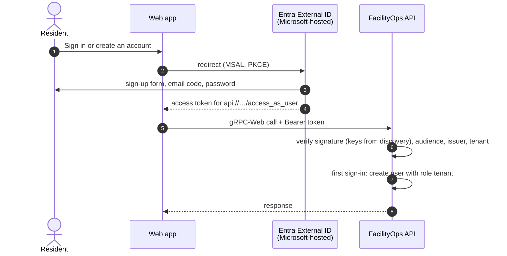

# Identity setup: residents and staff

How people sign in to FacilityOps AI outside local development, and how to set it up.

| Who | Directory | How they get an account | Role on first sign-in |
|---|---|---|---|
| **Residents** | Microsoft Entra **External ID** (`<subdomain>.ciamlogin.com`) | Sign up themselves: email + password, email verified with a one-time code | `tenant` |
| **Staff** | Your organisation's **workforce** Entra ID | Their existing work account | none: an administrator assigns `technician`, `facility_manager` or `admin` |
| Developers | none (local only) | Choose a demo account (sent as the `X-Dev-User` header) | `tenant` |

FacilityOps never stores passwords. Sign-up, email verification, password reset and multi-factor
authentication happen on Microsoft's hosted pages; the app receives a signed access token, and the backend
validates it against the directory that issued it (`backend/app/api/token_validation.py`). Roles live in the
FacilityOps database, so residents can never grant themselves staff permissions.



## 1. Create the external tenant (portal, about 2 minutes)

You need permission to create tenants in your subscription (Owner, Contributor or the *Tenant Creator* role).

1. Open the [Microsoft Entra admin center](https://entra.microsoft.com) signed in to your usual tenant.
2. **Entra ID** → **Overview** → **Manage tenants** → **Create**.
3. Choose **External**, then **Continue**.
4. **Basics:** a tenant name (for example *FacilityOps Residents*), a **domain name** (for example
   `facilityopsresidents`; this is your *subdomain*) and a **location**. The location can't be changed later.
5. **Add a subscription:** pick your subscription and a resource group. External ID is free up to its monthly
   active user allowance.
6. **Review + create**, and wait for the tenant to appear (a few minutes).

## 2. Configure it with the script

Sign in to the **new** tenant (it has no subscription, hence the flag), then run the setup script from the
repository root:

```bash
az login --tenant <external-tenant-id> --allow-no-subscriptions
scripts/setup_entra_external.sh --subdomain facilityopsresidents
# add --redirect-uri https://app.example.com for a deployed web app (repeatable)
```

It creates, or reuses when present:

- **FacilityOps API (residents)**: exposes the `access_as_user` scope and issues v2 tokens (the backend
  validates the v2 issuer).
- **FacilityOps web (residents)**: the single-page app with your redirect URIs, and admin consent so residents
  aren't asked to approve permissions.
- **FacilityOps residents sign-up**: an email + password sign-up and sign-in user flow that collects a display
  name, attached to the web app.

It ends by printing the settings to paste.

## 3. Run with Entra sign-in

Paste the printed settings into the backend `.env` and `frontend/.env.local`, then restart both. With
`AUTH_ENABLED=true` the demo accounts are gone and every call needs a token.

```bash
uvicorn backend.app.main:create_app --factory --reload
cd frontend && npm run dev
```

Open http://localhost:5173 and choose **Residents → Sign in or create an account**. After signing up, you land on
*Report a problem* as a tenant. To give someone a staff role, an administrator uses **Users** in the app; the
very first administrator comes from the CLI (use the user's Entra object id, shown on the Users page):

```bash
python -m backend.app.cli grant-role --provider entra_external --external-id <object-id> --role admin
```

## 4. Staff sign-in (workforce Entra ID)

Staff use your organisation's tenant instead. Register an API app (expose `access_as_user`, set
`requestedAccessTokenVersion` to 2) and a single-page app in the workforce tenant, then set `ENTRA_TENANT_ID`,
`ENTRA_API_AUDIENCE` (backend) and `VITE_ENTRA_CLIENT_ID`, `VITE_ENTRA_TENANT_ID`, `VITE_ENTRA_API_SCOPE`
(frontend). The sign-in page then shows a second door, **Staff → Sign in with your work account**. Staff get no
role until an administrator assigns one (`ENTRA_WORKFORCE_DEFAULT_ROLE` is empty by default).

## Bot protection and abuse

External ID's user flows have **no built-in CAPTCHA**. What protects self-service sign-up today:

- **Email verification:** an account can't be created without a code sent to the email address.
- **Least privilege:** a new resident can only submit requests and read their own; nothing else.
- **Rate limits:** each user is limited to `RATE_LIMIT_REQUESTS` intake submissions per window.
- **Fail-closed intake:** abusive content is screened by Content Safety and Prompt Shields, and dismissed
  requests carry a reason code (`abusive_or_spam`).

**Production upgrade:** turn on Microsoft's native integration with **Arkose Labs** or **HUMAN Security**
(configured through the Security Store in the Entra admin center). They challenge suspicious sign-ups on
Microsoft's hosted pages, which is where the protection has to be: a CAPTCHA on FacilityOps' own sign-in page
would not help, because bots can go straight to the hosted sign-up page.

## Notes

- **Token issuer:** External ID tokens use `https://<tenant-id>.ciamlogin.com/<tenant-id>/v2.0`; some have been
  seen with the `login.microsoftonline.com` form, so both are accepted. Signing keys come from each directory's
  OpenID discovery document and are cached.
- **MSAL authority:** the web app uses `https://<subdomain>.ciamlogin.com/<tenant-id>` (hence
  `VITE_EXTERNAL_TENANT_ID`). The bare `https://<subdomain>.ciamlogin.com/` form fails in MSAL with
  `endpoints_resolution_error`.
- **Direct "create account" link:** the sign-in button opens Microsoft's page, which offers *No account? Create
  one*. The `prompt=create` shortcut isn't officially documented for External ID and has a reported issue in
  hosted flows, so it isn't used.
- **Deploying:** add the deployed origin with `--redirect-uri` and re-run the script; set
  `FRONTEND_ORIGINS` and `ALLOWED_HOSTS` on the backend to match.
