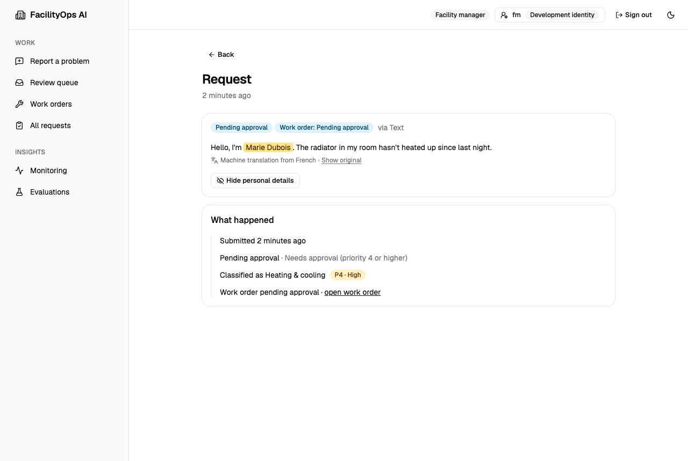

# Screenshots

One web app, four workspaces: each person sees only what their role allows. Screenshots use the synthetic demo
data from `python scripts/seed_demo.py`; every name and address is invented.

## Tenant: report a problem and follow it

Report by text, photo, voice note or a scanned letter or form, in English, Spanish or French. Emergencies (gas,
fire, flooding) skip the AI and go straight to the on-call team. Uploads are checked by their bytes, pictures by
Content Safety, and text found in a photo or scan by Prompt Shields as a document, so an instruction hidden in a
scan can't steer the AI. Names and phone numbers are redacted before any AI sees them, shown here as "personal
detail".

| Report a problem | My requests |
|---|---|
|  |  |

  
  

## Facility manager: review queue, approvals and assignment

Everything the workflow won't decide alone lands in the review queue, emergencies first, with the reason in plain
words. Managers approve high-priority work, assign technicians, and can reveal the redacted details of a
request; every reveal is recorded in the audit log.

| Review queue | Work orders |
|---|---|
|  |  |

### Requests in other languages

Requests written in Spanish or French reach staff with an English machine translation from Azure AI Translator,
clearly labelled, with the tenant's original one click away. Only redacted text is translated, so revealing
personal details works on the translation too.

## Technician: my work orders

Technicians see only their own assignments, reveal details only for work assigned to them, and mark jobs done.

## Administrator: access, quality and monitoring

Administrators manage users and roles but can't read personal data or approve work (separation of duties). They
track evaluation results over time and watch how the intake pipeline and its AI agents behave: counts and
timings only, never request content.

| Users and roles | Evaluations |
|---|---|
|  |  |

| Intake monitoring | Agent monitoring (dark mode) |
|---|---|
|  |  |
