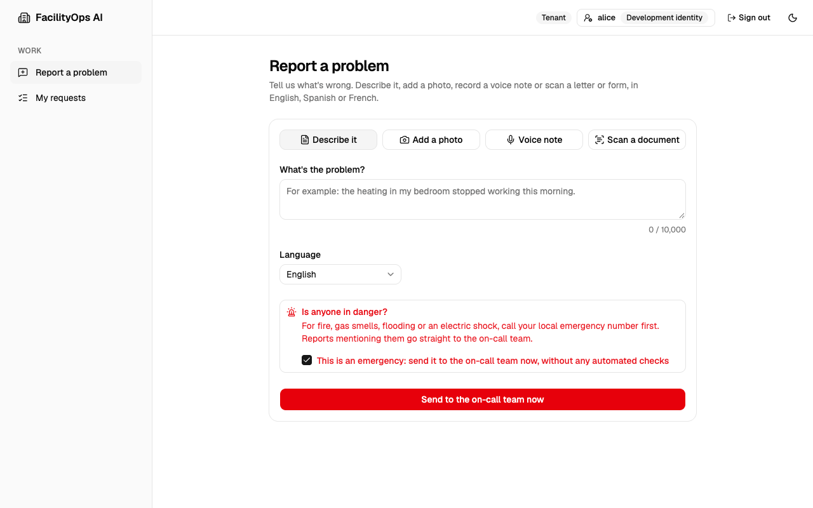
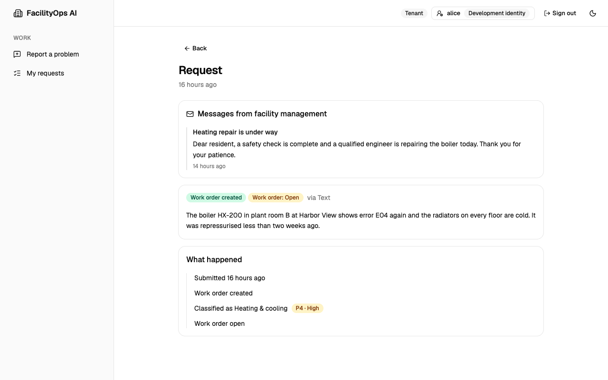
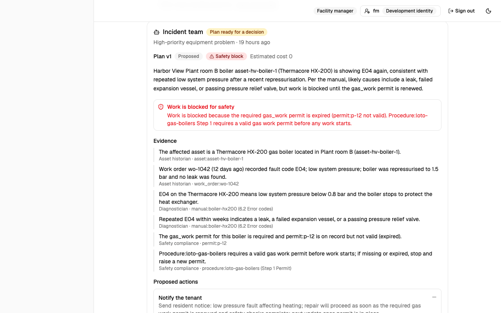
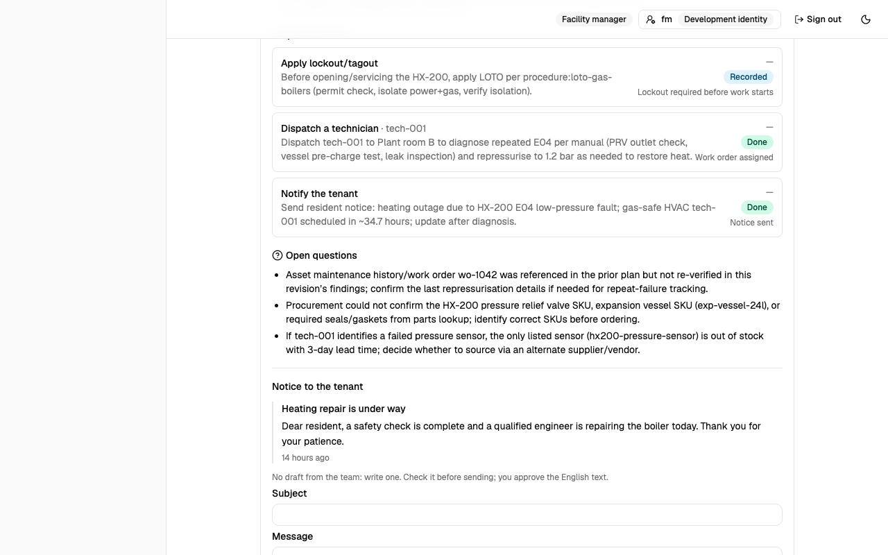

# Screenshots

One web app, four workspaces: each person sees only what their role allows. Screenshots use synthetic data only
(`python scripts/seed_demo.py`, plus incidents from live runs of the AI incident team on the synthetic facility
world); every name, building and manual is invented. For a 70-second walkthrough, see the demo at the top of the
[README](../README.md).

## Tenant: report a problem and follow it

Report by text, photo, voice note or a scanned letter or form, in English, Spanish or French. Emergencies (gas,
carbon monoxide, fire, electrical hazards, flooding) skip the AI and go straight to the on-call team. Uploads are checked by their bytes, pictures by
Content Safety, and text found in a photo or scan by Prompt Shields as a document, so an instruction hidden in a
scan can't steer the AI. Names and phone numbers are redacted before any AI sees them, shown here as "personal
detail".

| Report a problem | My requests |
|---|---|
|  |  |

  
  

Rules can miss an unusual description of an emergency, so a tenant can also say so directly: ticking **This is an
emergency** sends the report to the on-call team at once, before any check or AI, even with no text. Notices from
facility management appear on the request; a tenant who wrote in Spanish or French reads them machine-translated
into their language, with the approved English one click away.

| Declaring an emergency | A notice from facility management |
|---|---|
|  |  |

## Facility manager: review queue, approvals and assignment

Everything the workflow won't decide alone lands in the review queue, emergencies first, with the reason in plain
words. Managers approve high-priority work, assign technicians, and can reveal the redacted details of a
request; every reveal is recorded in the audit log.

| Review queue | Work orders |
|---|---|
|  |  |

### Requests in other languages

Requests written in Spanish or French reach staff with an English machine translation from Azure AI Translator,
clearly labelled, with the tenant's original one click away. Only redacted text is translated, so revealing
personal details works on the translation too.

## Facility manager: the AI incident team

High-priority equipment problems go to a team of AI agents that investigates with read-only tools and the
equipment manuals, then proposes a plan. Every claim cites the manual section, procedure or record it came from;
a claim without one is marked unverified. A plan with a safety block can't be approved: here the boiler's gas
work permit has expired, so code disables **Approve plan** and the manager can only revise or reject it.

After a revision is approved, the application (not the AI) carries out each action and shows what it did: the
lockout is recorded, the named technician is assigned, and the tenant notice, approved by the manager, is sent.

### Why this decision

Every request has a decision trail: each check and its result, every model call with the exact (redacted) input
and output, every tool call and every human decision. Opening the model content is itself recorded in the audit
log.

## Technician: my work orders

Technicians see only their own assignments, reveal details only for work assigned to them, and mark jobs done.

## Administrator: access, quality and monitoring

Administrators manage users and roles but can't read personal data or approve work (separation of duties). They
track evaluation results over time and watch how the intake pipeline and its AI agents behave: counts and
timings only, never request content.

| Users and roles | Evaluations |
|---|---|
|  |  |

| Intake monitoring | Agent monitoring (dark mode) |
|---|---|
|  |  |
